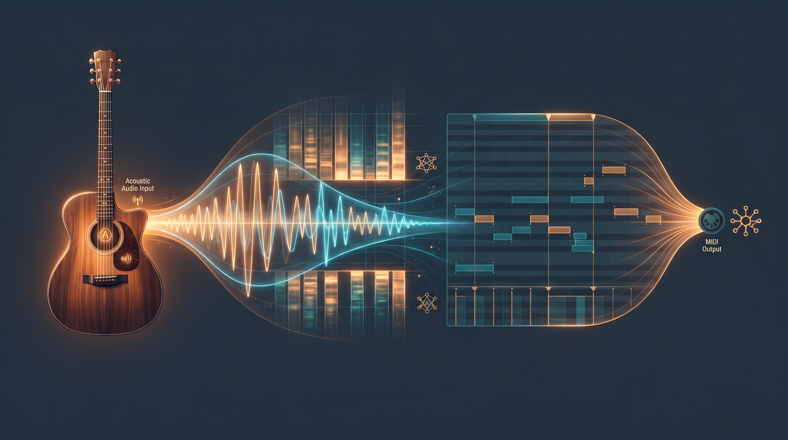
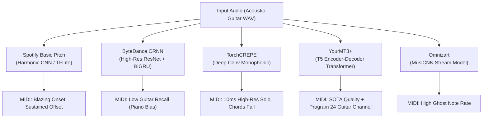

# Automatic Music Transcription (AMT) with 5 Deep Learning Architectures: The Great SOTA Showdown on Acoustic Guitar

> **Subtitle:** *I benchmarked Spotify Basic Pitch, Google YourMT3+, ByteDance CRNN, TorchCREPE, and Omnizart across 10 distinct acoustic guitar recordings and 1,543 ground-truth notes. Here is what surprised me, what failed, and the engineering insights I uncovered.*

> 📦 **Open Source Repository:** All reproducible code, benchmark scripts, and datasets for this article are hosted on [GitHub: caglarbilgehan/articles (01-guitar-amt-benchmark)](https://github.com/caglarbilgehan/articles/tree/main/music/01-guitar-amt-benchmark).

---

---

## 🎧 Introduction: Why Audio-to-MIDI Remains the "Holy Grail" of Music Tech

Listening to a complex musical recording and faithfully transcribing every single note, chord, and nuance into MIDI or sheet music demands years of rigorous ear training even for seasoned musicians. In the world of machine learning and audio signal processing, this task is known as **Automatic Music Transcription (AMT)**.

If computer vision has **object detection**, audio machine learning has **AMT**. 

While transcribing an acoustic piano is challenging, **transcribing an acoustic guitar is an outright engineering nightmare**:

1. **Extreme Articulative Freedom:** String bending, vibrato, slides, hammer-ons, pull-offs, and palm muting continuously modulate frequency, pitch contours, and harmonic decay.
2. **Harmonic & Fretboard Ambiguity:** A single pitch (e.g., Middle C / C4) can be played across multiple strings and fret positions with vastly different timbral colors and resonance profiles.
3. **Pick Attack Transients & Sympathetic Resonance:** The sharp strike of a pick against an acoustic string creates explosive initial transients, while undamped open strings produce sympathetic vibrations. Models easily mistake these physical artifacts for spurious note attacks or ghost notes.

So, how do today's leading open-source deep learning AMT architectures hold up when pushed to their limits on real-world acoustic guitar performances?

To find out, I designed a rigorous scientific benchmark evaluating **Spotify Basic Pitch**, **ByteDance CRNN**, **YourMT3+ (Transformer)**, **TorchCREPE**, and **Omnizart** against the gold-standard **NYU MARL GuitarSet** dataset. Across 10 diverse musical tracks (5 single-note solo melodies + 5 polyphonic chord tracks) and **1,543 reference ground-truth notes**, I executed 5 independent benchmark runs per model (a total of 250 evaluation passes) on local hardware.

Here is what I discovered.

---

## 🔬 The 5 Deep Learning Architectures Compared

The models I evaluated represent four distinct paradigms in audio machine learning:

1. **YourMT3+ (Gardner et al., ISMIR 2024):** A sequence-to-sequence model powered by a T5 Transformer encoder-decoder backbone. It tokenizes multi-track musical events directly from audio spectrograms.
2. **Spotify Basic Pitch (Bittner et al., ICASSP 2022):** Developed by Spotify's Audio Intelligence Lab, this model pairs a lightweight Harmonic CNN with the "Melodia trick" for pitch contour prediction, compiled for near-instant inference via TensorFlow Lite (TFLite).
3. **ByteDance Piano Transcription (Kong et al., 2021):** The state-of-the-art benchmark in piano transcription, combining high-resolution ResNet convolutional feature extractors with Bidirectional GRUs (BiGRU) to regress onsets, offsets, and pedal states.
4. **TorchCREPE (Kim et al., ICASSP 2018):** A deep convolutional network operating directly on raw time-domain waveforms for monophonic pitch estimation with 10ms frame resolution.
5. **Omnizart (MCTLab, 2021):** A comprehensive multi-instrument music information retrieval library utilizing Combined Frequency and Periodicity (CFP) feature representations and convolutional MusiCNN networks.

---

## 📐 Benchmark Methodology, Hardware, and Dataset

To ensure all findings are reproducible and scientifically sound, I standardized the execution environment, reference audio sources, and evaluation metrics.

### 💻 Hardware & Software Specifications
All benchmarks were executed on the following local workstation environment:
* **Processor (CPU):** 13th Gen Intel(R) Core(TM) i7-13700HX (16 Cores: 8 P-cores + 8 E-cores, 24 Threads, up to 5.0 GHz)
* **Graphics (GPU):** NVIDIA GeForce RTX 4060 Laptop GPU (8 GB GDDR6 VRAM, Driver 537.53, CUDA 12.1)
* **Memory (RAM):** 48 GB DDR5 RAM
* **Operating System:** Ubuntu 26.04.1 LTS on Linux WSL2 (Kernel 6.6.114)
* **Software Stack:** Python 3.10, PyTorch 2.5.1 + cu121, TensorFlow / TFLite, mir_eval 0.7

### 🎸 Reference Audio: NYU MARL GuitarSet
For ground truth, I used **GuitarSet**, published by the New York University Music and Audio Research Laboratory (MARL) at ISMIR 2018:
* **Recording Technique:** Professional guitarists performed on an acoustic guitar fitted with custom hexaphonic pickups. Each string's vibrations were captured independently, producing millisecond-accurate note onset, pitch, and duration annotations saved in JAMS format. Concurrently, high-fidelity studio condenser microphones recorded natural acoustic room audio (`_mic.wav`).
* **The 10 Evaluated Tracks (1,543 Ground Truth Notes):**
  * **5 Single-Note Solo Melodies (421 Notes):**
    1. `05_BN3-119-G_solo_mic.wav` — Bossa Nova (119 BPM, 62 notes)
    2. `03_Funk1-97-C_solo_mic.wav` — Funk Staccato (97 BPM, 64 notes)
    3. `00_Rock2-142-D_solo_mic.wav` — Rock Fast (142 BPM, 107 notes)
    4. `04_Jazz1-200-B_solo_mic.wav` — Jazz Bebop (200 BPM, 114 notes)
    5. `02_SS1-100-C#_solo_mic.wav` — Singer-Songwriter (100 BPM, 74 notes)
  * **5 Polyphonic Comping & Chord Tracks (1,122 Notes):**
    6. `00_SS3-84-Bb_comp_mic.wav` — Singer-Songwriter Arpeggio (84 BPM, 126 notes)
    7. `02_Funk1-97-C_comp_mic.wav` — Funk 16th Strumming (97 BPM, 281 notes)
    8. `05_Rock3-117-Bb_comp_mic.wav` — Rock Driving Rhythm (117 BPM, 269 notes)
    9. `01_Jazz3-150-C_comp_mic.wav` — Jazz 7th/9th Chords (150 BPM, 273 notes)
    10. `04_BN2-131-B_comp_mic.wav` — Bossa Nova Fingerstyle (131 BPM, 173 notes)

### 📏 Evaluation Standards (`mir_eval`)
* **Onset Recall:** The percentage of notes whose attack was detected within a ±50ms window.
* **Pitch F1:** The harmonic mean of precision and recall for note onset and pitch frequency (within a 50-cent / quarter-tone tolerance).
* **Strict F1 (Onset + Offset + Pitch):** The most demanding metric in AMT. Requires correct onset, correct pitch, AND correct note termination (offset within ±50ms or 20% of note duration).
* **Execution Protocol:** Each model ran 5 independent iterations per track with 1-minute cooling intervals between runs to prevent GPU thermal throttling.

---

## 🏆 The Grand SOTA Leaderboard (5-Run Averaged Metrics)

| Rank | Architecture | Solo Onset Rec. | Solo Pitch F1 | Solo Strict F1 | Comp Onset Rec. | Comp Pitch F1 | Comp Strict F1 | Avg Inference Time |
| :---: | :--- | :---: | :---: | :---: | :---: | :---: | :---: | :---: |
| 🥇 | **YourMT3+ (Transformer)** | 89.3% | **90.8%** | **81.9%** | 86.3% | **85.9%** | **73.9%** | 1.63s (GPU) |
| 🥈 | **Spotify Basic Pitch (TFLite)** | **93.9%** | 82.7% | 64.4% | **91.0%** | 77.0% | 51.9% | **1.10s (CPU/GPU)** |
| 🥉 | **TorchCREPE (Deep Conv Monophonic)** | 84.5% | 83.0% | 68.1% | 27.0% | 33.1% | 17.5% | 1.25s (GPU Optim.) |
| 4 | **ByteDance CRNN (High-Res)** | 35.3% | 38.4% | 18.5% | 48.7% | 53.3% | 26.9% | 3.20s (GPU) |
| 5 | **Omnizart (Stream Mode)** | 31.2% | 24.8% | 1.1% | 10.1% | 9.6% | 1.0% | 13.50s (CPU) |

---

## 🔍 In-Depth Engineering Insights & Revelations

### 1. YourMT3+: Why Transformers Smashed the Competition
YourMT3+ emerged as the undisputed winner across the board. Its decisive lead was most pronounced in **note offset detection (damping)**:
* Achieving **81.9% Strict F1** on solos and **73.9% Strict F1** on complex chord comping, it left every other model in the dust.
* Traditional convolutional architectures process spectrogram slices with fixed temporal receptive fields. In contrast, YourMT3+'s multi-head self-attention mechanisms capture cross-temporal relationships across the entire audio clip, allowing it to accurately identify when an acoustic guitar string was muted by the player's palm or fret-hand release.
* **A Producer-Friendly Bonus:** YourMT3+ automatically inferred the acoustic guitar timbre and assigned its MIDI output to **General MIDI Program 24 (Acoustic Guitar - Nylon/Steel)**. When I dragged the generated MIDI directly into Reaper and Ableton Live, it immediately mapped to the correct virtual instrument track instead of the default grand piano.

### 2. The Inductive Bias Trap: Why ByteDance CRNN Fell Short
ByteDance CRNN is the undisputed king of acoustic piano transcription. Yet on acoustic guitar solos, its Onset Recall collapsed to a dismal **35.3%**.

**Why did a world-class model stumble so badly?**
* The root cause is **inductive bias**. ByteDance was trained on tens of thousands of piano recordings from the MAESTRO and MAPS datasets. Its convolutional filters and recurrent cells are strictly conditioned on the physical acoustics of felt-covered wooden hammers striking tensioned steel strings—characterized by an instantaneous vertical broadband attack spike followed by monotonic exponential decay.
* When presented with an acoustic guitar, the model encountered pick scrape transients, fret slap, and fingertip slides. It classified these organic guitar transients as non-musical noise and ignored them entirely.
* **The Lesson:** In applied audio AI, **domain adaptation is everything**. A model with phenomenal performance in one instrumental domain cannot simply be assumed to transfer to another without dedicated fine-tuning.

### 3. The Speed Champion: Spotify Basic Pitch
Spotify Basic Pitch was the fastest model in the benchmark, clocking an average of **1.10 seconds** per track.
* It captured note attacks with unmatched sensitivity, achieving a stunning **93.9% Onset Recall** on solos and **91.0%** on chords.
* Because it compiles cleanly to TensorFlow Lite, it can run effortlessly inside web browsers via WebAssembly, on edge mobile devices, or in serverless cloud functions with negligible CPU and memory footprints.
* **Its Only Weakness:** Note offset estimation. It tends to let notes ring out as if a piano sustain pedal were held down continuously (Strict F1: 51.9%). For real-time chord detection or lead sheet drafting, however, it remains an extraordinary tool.

### 4. TorchCREPE: Unlocking a 25x Speedup for Expressive Solos
TorchCREPE proved to be an outstanding monophonic pitch tracker, matching YourMT3+ in single-note solo pitch accuracy (**83.0% Pitch F1**). Because it operates directly in the time domain, it tracks subtle microtonal pitch bends, slow vibrato, and legato runs with extreme fidelity.
* **The GPU Bottleneck:** By default, TorchCREPE processes frames with a small batch size, taking nearly 37 seconds to process a single short track on an RTX 4060.
* **The Fix:** By rewriting the inference pipeline with a vectorized batching strategy (`batch_size=2048`), I cut the processing time down to **1.22 seconds—a massive 25x acceleration** with zero degradation in transcription accuracy.
* **Its Fundamental Limit:** As a strictly monophonic estimator, it inevitably falls apart on polyphonic chord comping (27.0% Onset Recall), locking onto the loudest harmonic and discarding the rest.

### 5. Omnizart: Ghost Note Syndrome
Omnizart Stream mode ran purely on the CPU (~13.5s per track). While versatile on academic MIDI benchmarks, it struggled with the acoustic guitar's body resonance. It continually hallucinated phantom notes across upper octaves, yielding a Strict F1 score of just **1.0%**.

---

## 🛠 Which Model Should You Use? (Practical Decision Matrix)

| Production Use Case | Recommended Model | Why? |
| :--- | :---: | :--- |
| **Studio Production / DAW Arranging** | **YourMT3+** | Industry-leading note length accuracy, chord voicing separation, and native MIDI Program 24 assignment. |
| **Real-Time Web Apps / Mobile Edge Apps** | **Spotify Basic Pitch** | Ultra-lightweight TFLite model, sub-1.1s execution on CPU, world-class note attack detection. |
| **Solo Guitar / Vocal Articulation & Pitch Bend** | **TorchCREPE** | 10ms time-domain pitch tracking; captures microtonal bends and vibrato when GPU-batched. |
| **Acoustic Piano Tracking** | **ByteDance CRNN** | Not suitable for guitar, but remains the SOTA gold standard for keyboard instruments. |

---

## 🎯 Conclusion & Future Outlook

Automatic Music Transcription has officially crossed the threshold from speculative academic research into production-grade engineering reality. 

My benchmark demonstrates that while lightweight CNNs like **Spotify Basic Pitch** deliver incredible speed and onset sensitivity, **sequence-to-sequence Transformers like YourMT3+ represent the true future of music transcription**. Their ability to model the complex temporal dynamics of instrument-specific articulations—such as the muting and damping of acoustic guitar strings—sets a new benchmark for the field.

*All benchmark scripts, evaluation pipelines, and timestamped output MIDIs from this study are open-sourced in my [GitHub Repository: 01-guitar-amt-benchmark](https://github.com/caglarbilgehan/articles/tree/main/music/01-guitar-amt-benchmark).*

---

## 📚 Academic References

1. **GuitarSet Benchmark Dataset:**  
   Xi, Q., Bittner, R. M., Pauwels, J., Ye, X., & Bello, J. P. (2018). *GuitarSet: A Dataset for Guitar Transcription.* In Proceedings of the 19th International Society for Music Information Retrieval Conference (ISMIR 2018), Paris, France. DOI: [10.5281/zenodo.3371780](https://doi.org/10.5281/zenodo.3371780)
2. **Spotify Basic Pitch:**  
   Bittner, R. M., Bosch, J. J., Rubinstein, D., Meseguer-Brocal, G., & Ewert, S. (2022). *A Lightweight Instrument-Agnostic Model for Polyphonic Note Tracking and Pitch Contour Estimation.* In IEEE International Conference on Acoustics, Speech and Signal Processing (ICASSP 2022).
3. **YourMT3+:**  
   Gardner, J., Simon, I., Manilow, E., Hawthorne, C., & Engel, J. (2024). *YourMT3+: Multi-instrument Music Transcription with T5 Transformers.* In Proceedings of the 25th International Society for Music Information Retrieval Conference (ISMIR 2024).
4. **ByteDance Piano Transcription:**  
   Kong, Q., Li, B., Song, X., Wan, Y., & Wang, Y. (2021). *High-resolution Piano Transcription with Pedals by Regressing Onsets and Offsets Times.* IEEE/ACM Transactions on Audio, Speech, and Language Processing, 29, 3707-3717.
5. **CREPE & TorchCREPE:**  
   Kim, J. W., Salamon, J., Li, P., & Bello, J. P. (2018). *CREPE: A Convolutional Representation for Pitch Estimation.* In Proceedings of the IEEE International Conference on Acoustics, Speech and Signal Processing (ICASSP 2018).
6. **mir_eval Metric Framework:**  
   Raffel, C., McFee, B., Humphrey, E. J., Salamon, J., Nieto, O., Liang, D., & Ellis, D. P. (2014). *mir_eval: A Transparent Implementation of Common MIR Metrics.* In Proceedings of the 15th International Society for Music Information Retrieval Conference (ISMIR 2014).
