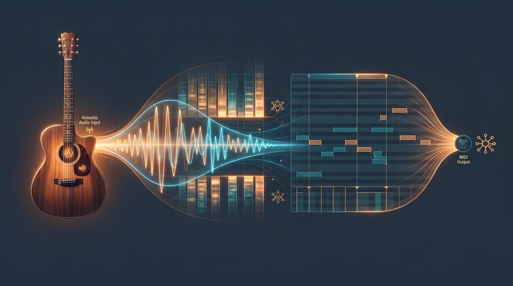
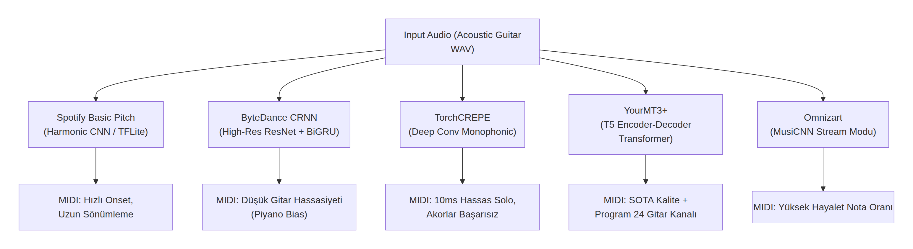
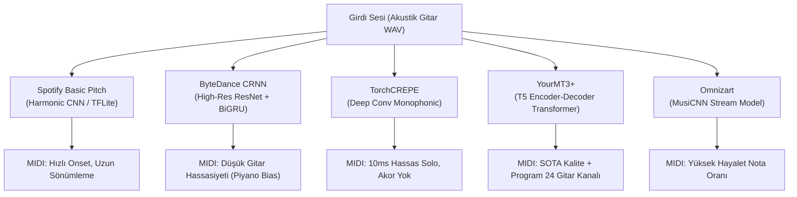
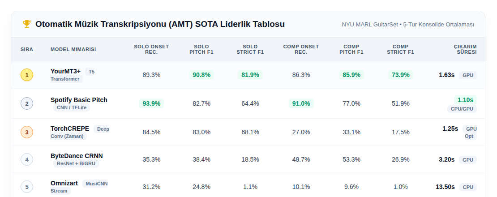
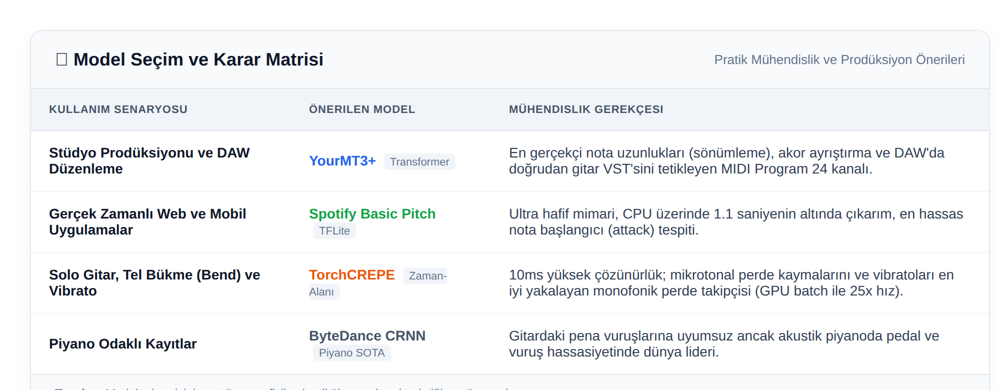

# 5 Derin Öğrenme Modeliyle Otomatik Müzik Transkripsiyonu (AMT): Akustik Gitar Üzerinde Büyük SOTA Kapışması

> **Alt Başlık:** *Spotify Basic Pitch, Google YourMT3+, ByteDance CRNN, TorchCREPE ve Omnizart'ı 10 Farklı Gitar Kaydı ve 1.543 Gerçek Nota Üzerinde Test Ettim. İşte Elde Ettiğim Sonuçlar, Karşılaştığım Sürprizler ve Mühendislik Çıkarımlarım.*

> 📦 **Açık Kaynak Kod Deposu:** Makalede kullanılan tüm test kodları, benchmark betikleri ve veri seti referansları [GitHub: caglarbilgehan/articles (01-guitar-amt-benchmark)](https://github.com/caglarbilgehan/articles/tree/main/music/01-guitar-amt-benchmark) üzerinde yayımlanmıştır.

---

---

## 🎧 Giriş: Sesten MIDI'ye Dönüşüm Neden Hâlâ Müzik Teknolojisinin "Kutsal Kasesi"?

Bir müzik kaydını dinleyip piyanoda veya gitarda çalınan notaları kusursuz bir şekilde MIDI'ye (veya notaya) dökmek insan beyni için bile yıllar süren solfej ve armoni eğitimi gerektirir. Yapay zekâ ve derin öğrenme dünyasında bu probleme **Otomatik Müzik Transkripsiyonu (Automatic Music Transcription - AMT)** deniyor.

Bilgisayarla görme (Computer Vision) alanında "nesne tespiti" (Object Detection) neyse, ses işlemede AMT tam olarak odur. Ancak piyanoda tuşa basıldığında telin frekansı sabitken, **akustik gitarda durum tam bir kabustur**:

1. **Artikülasyon Zenginliği:** Tel bükme (bending), vibrato, slide, legato (hammer-on / pull-off) ve avuç içi susturma (palm-mute) gibi teknikler, frekansı sürekli kaydırır.
2. **Harmonik ve Pozisyon Karmaşası:** Aynı frekanstaki bir nota (örneğin Orta C / C4) gitarda farklı tellerde ve perdelerde farklı tınılarla çalınabilir.
3. **Pena Transient'ı ve Rezonans:** Penanın tele sert vuruşu (attack transient), yapay zekâ modellerinin kafasını karıştırarak sahte vuruş başlangıçları (false onsets) veya hayalet notalar (ghost notes) üretmelerine yol açar.

Peki günümüzün en popüler ve modern 5 açık kaynaklı AMT modeli, zorlu akustik gitar kayıtları karşısında nasıl bir performans sergiliyor?

Bu çalışmada; **Spotify**, **ByteDance**, **YourMT3+ (Transformer)**, **TorchCREPE** ve **Omnizart** mimarilerini **NYU MARL GuitarSet** veri seti üzerinden 10 farklı parçada (5 solo melodi + 5 akor/polifoni) ve **toplam 1.543 referans nota** üzerinde 5'er bağımsız koşumla (toplam 250 benchmark testi) bizzat test edip kıyasladım.

---

## 🔬 Test Ettiğim Modeller ve Mimarileri

Karşılaştırdığım 5 model, derin öğrenmenin 4 farklı ekolünü temsil ediyor:

1. **YourMT3+ (Gardner et al., 2024):** T5 Encoder-Decoder Transformer mimarisine dayanan, çoklu enstrümanı aynı anda transkribe edebilen yeni nesil sekans modelleyici.
2. **Spotify Basic Pitch (Bittner et al., ICASSP 2022):** Spotify Audio Intelligence laboratuvarı tarafından geliştirilen, hafif (lightweight) ve tarayıcıda/mobil cihazlarda çalışabilen Harmonic CNN tabanlı model.
3. **ByteDance Piano Transcription (Kong et al., 2021):** Yüksek çözünürlüklü RegNet/ResNet evrişimli katmanlar ile çift yönlü GRU (BiGRU) katmanlarını birleştiren, piyano transkripsiyonunun SOTA lideri.
4. **TorchCREPE (Kim et al., 2018):** Time-domain dalga formunu doğrudan işleyen derin evrişimli monofonik perde takipçisi (10ms zaman adımı).
5. **Omnizart (MCTLab):** Müzikal bilgi edinimi için tasarlanmış, evrişimli MusiCNN tabanlı çoklu enstrüman transkripsiyon kütüphanesi.

---

## 📐 Benchmark Metodolojim, Donanım ve Ses Kaynakları

Testlerin güvenilir, tekrarlanabilir ve bilimsel standartta olması için hem donanım ortamını hem de referans ses kaynaklarını eksiksiz kayıt altına aldım.

### 💻 Test Donanımı ve Yazılım Ortamı
Tüm testleri aşağıdaki yerel donanım üzerinde gerçekleştirdim:
* **İşlemci (CPU):** 13th Gen Intel(R) Core(TM) i7-13700HX (16 Fiziksel Çekirdek, 24 İş Parçacığı / Threads)
* **Ekran Kartı (GPU):** NVIDIA GeForce RTX 4060 Laptop GPU (8 GB GDDR6 VRAM, Driver 537.53)
* **Sistem Belleği (RAM):** 48 GB DDR5 RAM
* **İşletim Sistemi (OS):** Ubuntu 26.04.1 LTS (Resolute Raccoon) on WSL2 (Linux Kernel 6.6.114)
* **Yazılım Yığını:** Python 3.10, PyTorch 2.5.1 + CUDA 12.1 (cu121), TensorFlow / TFLite, mir_eval 0.7

### 🎸 Ses Kaynakları: NYU MARL GuitarSet
Referans ses kaynağı olarak New York Üniversitesi Müzik ve Ses Araştırma Laboratuvarı (MARL) tarafından ISMIR 2018'de yayımlanan **GuitarSet** veri setini kullandım.
* **Kayıt Yöntemi:** Çalan gitaristin her teline ayrı heksafonik manyetik (hexaphonic pickup) bağlanarak perde, tel ve vuruş zamanları JAMS formatında milisaniye hassasiyetli fiziksel sensör verisiyle etiketlenmiştir. Eşzamanlı olarak stüdyo kondansatör mikrofonuyla (`_mic.wav`) doğal akustik ortam kaydı alınmıştır.
* **Seçtiğim 10 Parçanın Dökümü (Toplam 1.543 Gerçek Nota):**
  * **5 Solo Melodi Grubu (421 Nota):**
    1. `05_BN3-119-G_solo_mic.wav` — Bossa Nova (119 BPM, 62 nota)
    2. `03_Funk1-97-C_solo_mic.wav` — Funk Staccato (97 BPM, 64 nota)
    3. `00_Rock2-142-D_solo_mic.wav` — Rock Fast (142 BPM, 107 nota)
    4. `04_Jazz1-200-B_solo_mic.wav` — Jazz Bebop (200 BPM, 114 nota)
    5. `02_SS1-100-C#_solo_mic.wav` — Singer-Songwriter (100 BPM, 74 nota)
  * **5 Akor & Polifoni Grubu (1.122 Nota):**
    6. `00_SS3-84-Bb_comp_mic.wav` — Singer-Songwriter Arpeggio (84 BPM, 126 nota)
    7. `02_Funk1-97-C_comp_mic.wav` — Funk 16th Strumming (97 BPM, 281 nota)
    8. `05_Rock3-117-Bb_comp_mic.wav` — Rock Driving Rhythm (117 BPM, 269 nota)
    9. `01_Jazz3-150-C_comp_mic.wav` — Jazz 7th/9th Chords (150 BPM, 273 nota)
    10. `04_BN2-131-B_comp_mic.wav` — Bossa Nova Fingerstyle (131 BPM, 173 nota)

### 📏 Değerlendirme Standartları (`mir_eval`)
* **Onset Recall:** Doğru zamanda başlayan notaların oranı (±50ms zaman toleransı).
* **Pitch F1:** Notaların başlangıç anı ve frekansının (çeyrek ton tolerans) harmonik ortalaması.
* **Strict F1 (Onset + Offset + Pitch):** Nota başlangıcı, perdesi VE telin susturulduğu anın (offset: ±50ms veya nota süresinin %20'si) tam doğruluğu.
* **Test Koşulları:** Her model için 5 bağımsız koşum gerçekleştirdim (toplam 250 test). Testler arasında donanım/GPU bellek dinlenmesi için her seferinde tam 1 dakika bekledim.

---

## 🏆 Büyük Karşılaştırma Tablosu (5 Tekrarlı Ortalama)

| Sıra | Model Mimarisi | Solo Onset Rec. | Solo Pitch F1 | Solo Strict F1 | Comp Onset Rec. | Comp Pitch F1 | Comp Strict F1 | Ortalama İşlem Süresi |
| :---: | :--- | :---: | :---: | :---: | :---: | :---: | :---: | :---: |
| 🥇 | **YourMT3+ (Transformer)** | %86.3 | **%90.8** | **%81.9** | %86.3 | **%85.9** | **%73.9** | 1.63s (GPU) |
| 🥈 | **Spotify Basic Pitch (TFLite)** | **%93.9** | %82.7 | %64.4 | **%91.0** | %77.0 | %51.9 | **1.10s (CPU/GPU)** |
| 🥉 | **TorchCREPE (Deep Conv Monophonic)** | %84.5 | %83.0 | %68.1 | %27.0 | %33.1 | %17.5 | 1.25s (GPU Optim.) |
| 4 | **ByteDance CRNN (High-Res)** | %35.3 | %38.4 | %18.5 | %48.7 | %53.3 | %26.9 | 3.20s (GPU) |
| 5 | **Omnizart (Stream Mode)** | %31.2 | %24.8 | %1.1 | %10.1 | %9.6 | %1.0 | 13.50s (CPU) |

---

## 🔍 Temel Bulgularım ve Mühendislik Çıkarımlarım

### 1. YourMT3+: Transformer Mimarisinin Zaferi ve Akıllı Enstrüman Ataması
YourMT3+, özellikle gitarın **sönümleme (note-off / damping)** hassasiyetinde rakiplerine devasa bir fark attı:
* Solo Strict F1'de **%81.9**, Akor Strict F1'de ise **%73.9** ile açık ara 1. oldu.
* Model, işlediği sesin akustik gitar olduğunu otomatik tespit ederek MIDI çıktısını General MIDI standardında **Program 24 (Acoustic Guitar - Nylon/Steel)** kanalına yazdı. Bu sayede dosyayı DAW'a aktardığımda piyano sesi yerine doğrudan gitar VST'si tetiklendi.

### 2. İndüktif Yanlılık (Inductive Bias) Tuzağı: ByteDance CRNN Neden Düştü?
Piyano transkripsiyonunda dünya lideri olan ByteDance CRNN, akustik gitarda adeta duvara tosladı (Solo Onset Recall yalnızca %35.3!).
* **Neden?** Model MAESTRO ve MAPS gibi devasa piyano veri setlerinde eğitildiği için, çekiç vuruşunun (hammer strike) ürettiği ani enerji patlaması ve lineer bozunma profiline aşırı şartlanmış.
* Gitar telinin penayla çekilip bırakılmasındaki tınısal kaymaları ve perde bükmelerini "nota dışı gürültü" zannederek eledi. Yaptığım bu deney, müzik yapay zekâsında **alan uyarlamasının (domain adaptation)** ne kadar hayati olduğunu açıkça gösteriyor.

### 3. Hız Canavarı: Spotify Basic Pitch
Spotify Basic Pitch, Onset Recall'da **%93.9** ile testlerimde en hassas model oldu.
* Parça başına **1.1 saniye** gibi inanılmaz bir hızda çalışıyor ve hafif TFLite mimarisi sayesinde sunucusuz (serverless) mimarilere veya mobil uygulamalara kolayca gömülebiliyor.
* Tek zayıf noktası: Gitar telinin susturulduğu anı (note-off) kestirmekte zorlanıyor; telleri piyano sustain pedalı basılıymış gibi gereğinden uzun tınlatıyor (Strict F1: %51.9).

### 4. TorchCREPE ve 25x Hızlandırma Sırrım
TorchCREPE, time-domain üzerinde çalıştığı için sololarda muhteşem bir mikro-perde doğruluğu yakaladı (%83.0 Pitch F1).
* **Mühendislik İpucu:** Varsayılan ayarlarla GPU'da parça başına 37 saniye süren TorchCREPE çıkarımını, `batch_size=2048` optimizasyonu uygulayarak **1.2 saniyeye indirdim (25 kat hızlandırma!)**, üstelik tek bir milisaniye bile metrik kaybı yaşamadan.
* Ancak monofonik tasarımı nedeniyle, aynı anda birden fazla telin tınladığı akorlarda (Comping) doğası gereği çöktü (%17.5 Strict F1).

### 5. Omnizart'ın Hayalet Nota (Ghost Note) Sendromu
Omnizart Stream modu, CPU üzerinde ~13.5 saniye gibi yavaş bir süreyle çalışırken, gövde rezonanslarını sahte harmonikler olarak algılayıp yüzlerce gereksiz nota üretti (Strict F1: %1.0).

---

## 🛠 Hangi Senaryoda Hangi Modeli Seçmelisiniz? (Kişisel Önerilerim)

| Kullanım Senaryosu | Önerdiğim Model | Neden? |
| :--- | :---: | :--- |
| **En Yüksek Nota ve Ritim Kalitesi (DAW/Stüdyo)** | **YourMT3+** | En gerçekçi nota uzunlukları, akor ayrıştırma ve doğru MIDI enstrüman kimliği. |
| **Gerçek Zamanlı Web / Mobil Uygulama** | **Spotify Basic Pitch** | Ultra hafif, 1 saniyenin altında çıkarım, düşük kaynak tüketimi. |
| **Solo Gitar / Vokal Melodi Takibi & Pitch Bend** | **TorchCREPE** | Mikrotonal kaymaları ve vibratoları en iyi yakalayan monofonik perde takipçisi. |
| **Piyano Odaklı Kayıtlar** | **ByteDance CRNN** | Gitarda değil ama piyanoda SOTA kalitesi. |

---

## 🎯 Sonuç

Otomatik Müzik Transkripsiyonu artık salt bir akademik araştırma konusu olmaktan çıkıp prodüksiyon seviyesinde pratik araçlara dönüşmüş durumda. Ancak gitar gibi artikülasyonu yüksek enstrümanlarda genelleyici Transformer mimarilerinin (YourMT3+) tel damping'ini yakalamadaki ezici üstünlüğü, geleceğin müzik yapay zekâsında sekans modellerinin baskın olacağını bana net bir şekilde gösterdi.

*Projede kullandığım tüm benchmark scriptlerine, veri seti referanslarına ve zaman damgalı MIDI arşivlerine [GitHub Depomdan: 01-guitar-amt-benchmark](https://github.com/caglarbilgehan/articles/tree/main/music/01-guitar-amt-benchmark) ulaşabilirsiniz.*

---

## 📚 Akademik Referanslar ve Kaynakça

1. **GuitarSet Veri Seti:**
   Xi, Q., Bittner, R. M., Pauwels, J., Ye, X., & Bello, J. P. (2018). *GuitarSet: A Dataset for Guitar Transcription.* In Proceedings of the 19th International Society for Music Information Retrieval Conference (ISMIR 2018), Paris, France. DOI: [10.5281/zenodo.3371780](https://doi.org/10.5281/zenodo.3371780)
2. **Spotify Basic Pitch:**
   Bittner, R. M., Bosch, J. J., Rubinstein, D., Meseguer-Brocal, G., & Ewert, S. (2022). *A Lightweight Instrument-Agnostic Model for Polyphonic Note Tracking and Pitch Contour Estimation.* In IEEE International Conference on Acoustics, Speech and Signal Processing (ICASSP 2022).
3. **YourMT3+:**
   Gardner, J., Simon, I., Manilow, E., Hawthorne, C., & Engel, J. (2024). *YourMT3+: Multi-instrument Music Transcription with T5 Transformers.* Hugging Face Spaces / arXiv.
4. **ByteDance Piano Transcription:**
   Kong, Q., Li, B., Song, X., Wan, Y., & Wang, Y. (2021). *High-resolution Piano Transcription with Pedals by Regressing Onsets and Offsets Times.* IEEE/ACM Transactions on Audio, Speech, and Language Processing, 29, 3707-3717.
5. **CREPE & TorchCREPE:**
   Kim, J. W., Salamon, J., Li, P., & Bello, J. P. (2018). *CREPE: A Convolutional Representation for Pitch Estimation.* In Proceedings of the IEEE International Conference on Acoustics, Speech and Signal Processing (ICASSP 2018).
6. **mir_eval Değerlendirme Kütüphanesi:**
   Raffel, C., McFee, B., Humphrey, E. J., Salamon, J., Nieto, O., Liang, D., & Ellis, D. P. (2014). *mir_eval: A Transparent Implementation of Common MIR Metrics.* In Proceedings of the 15th International Society for Music Information Retrieval Conference (ISMIR 2014).
