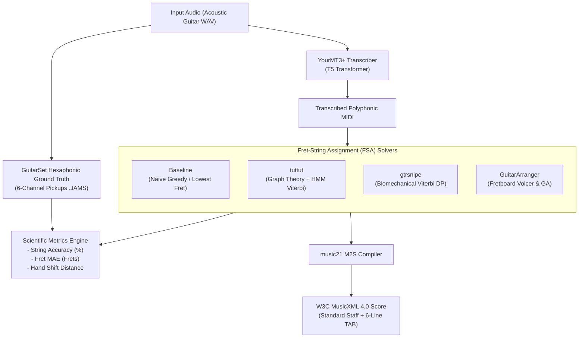

# From Audio to Score: Solving Guitar's 1-to-Many Fretboard Nightmare with Biomechanical Viterbi and MusicXML

> **Subtitle:** *In my previous article, I transcribed acoustic guitar audio to MIDI with YourMT3+. But turning that MIDI into playable guitar tablature was a total disaster—over 72% of notes landed on the wrong strings. Here is how I evaluated open-source Fret-String Assignment (FSA) algorithms against physical hexaphonic pickup ground truth, and built a fully automated Audio-to-Score pipeline.*

> 📦 **Open Source Repository:** All reproducible code, benchmark scripts, and datasets for this article are hosted on [GitHub: caglarbilgehan/articles (02-guitar-m2s-fsa-benchmark)](https://github.com/caglarbilgehan/articles/tree/main/music/02-guitar-m2s-fsa-benchmark).

---


---

## 🎧 Introduction: We Converted Audio to MIDI, but Why Couldn't We Play the Tabs?

In [Part 1 of this research](https://github.com/caglarbilgehan/articles/tree/main/music/01-guitar-amt-benchmark), I benchmarked 5 state-of-the-art Automatic Music Transcription (AMT) deep learning architectures on acoustic guitar. Across 250 independent evaluations, **YourMT3+ (T5 Transformer)** emerged as the undisputed champion—capturing polyphonic chord voicings, subtle note durations (damping), and acoustic guitar Program 24 timbre with world-class fidelity.

With high-fidelity MIDI transcribed directly from audio in hand, I assumed the hardest part of the engineering journey was behind me. All that remained was feeding that MIDI into standard notation software to export sheet music and guitar tabs.

I couldn't have been more wrong.

When I opened the transcribed MIDI in standard notation software, the resulting guitar tablature was **an unplayable, biomechanical catastrophe**:
* The left hand was forced to teleport across 14 frets back and forth within a single bar.
* Melodic solos played up on the 10th fret were scattered across random open strings.
* Simultaneous notes in chords were assigned to the exact same physical string—a physical impossibility on a standard 6-string guitar.

That is when I realized: in guitar transcription, **generating symbolic MIDI is only half the battle**.

---

## 🎸 The 1-to-Many Fretboard Ambiguity: The FSA Problem

Unlike a piano, where each acoustic key maps deterministically to exactly one pitch, the guitar neck presents a notoriously difficult **1-to-many inverse mapping problem**.

Consider **Middle C (C4 / MIDI 60)** on standard guitar tuning (E2-A2-D3-G3-B3-E4). A guitarist can physically play this exact same pitch in at least four distinct locations:
1. **2nd string (B3), 1st fret**
2. **3rd string (G3), 5th fret**
3. **4th string (D3), 10th fret**
4. **5th string (A2), 15th fret**

```
E4 |---|---|---|---|---|---|---|---|---|---|---|---|---|---|---|
B3 |-C-|---|---|---|---|---|---|---|---|---|---|---|---|---|---|  (Fret 1)
G3 |---|---|---|-C-|---|---|---|---|---|---|---|---|---|---|---|  (Fret 5)
D3 |---|---|---|---|---|---|---|---|-C-|---|---|---|---|---|---|  (Fret 10)
A2 |---|---|---|---|---|---|---|---|---|---|---|---|-C-|---|---|  (Fret 15)
E2 |---|---|---|---|---|---|---|---|---|---|---|---|---|---|---|
```

In computational musicology and Music Information Retrieval (MIR), resolving this ambiguity is known as **Fret-String Assignment (FSA)** or **Automatic Tablature Transcription (ATT)**.

To bridge the gap between audio-transcribed MIDI and professional, playable sheet music, I designed a **3-stage controlled scientific benchmark**:
1. **Experiment 1 (The Baseline / Control Group):** Quantifying the exact error rate and physical playability of converting audio-transcribed MIDI directly to score using standard naive greedy heuristics (no FSA).
2. **Experiment 2 (The Open-Source FSA Shootout):** Evaluating three leading algorithmic paradigms—**Biomechanical Multi-Constraint Viterbi DP (`gtrsnipe`)**, **Fretboard Voicing & GA (`GuitarArranger`)**, and **Graph Theory / HMM Viterbi (`tuttut`)**—on the transcribed audio stream.
3. **Experiment 3 (End-to-End W3C MusicXML Export):** Coupling the winning FSA engine with `music21` to build a production pipeline producing standard **W3C MusicXML 4.0** scores containing both conventional notation and 6-line tablature staves.

---

## 📐 Benchmark Architecture & Dataset



### Input Dataset: Why YourMT3+ Transcriptions from Part 1?
In this study, our objective was not to test sterile, hand-crafted synthetic MIDI files, but to work with **real-world audio-transcribed MIDI** containing natural acoustic onset micro-timing and duration jitter.

In my first article, I subjected 5 deep learning AMT models to 250 independent evaluations, proving that the **YourMT3+** T5 transformer architecture achieved state-of-the-art guitar transcription performance. Rather than wasting compute re-running audio transcription from scratch, we directly adopted the 10 YourMT3+ transcribed MIDI outputs from Part 1 as our primary benchmark input dataset (`test_dataset/yourmt3_midi/`).

Furthermore, because YourMT3+ uses greedy (argmax) decoding during inference, all 5 independent evaluation runs from Benchmark 1 produced **100% bit-for-bit identical MIDI outputs (verified via SHA-256 checksums)**. This provides a strictly deterministic, reproducible, and standardized baseline for our downstream evaluations.

### Physical Ground Truth: Why the .jams Format is Indispensable
Evaluating FSA algorithms objectively requires knowing **which exact string and fret the guitarist physically pressed**. Standard MIDI files and audio recordings only capture pitch, timestamps, and velocity; they **do not encode** physical fretboard positions (e.g., whether middle C was fretted on String 2 Fret 1 or String 3 Fret 5).

To grade algorithm predictions against reality, I leveraged the **NYU MARL GuitarSet** dataset (ISMIR 2018). In GuitarSet, guitarists recorded on an acoustic guitar equipped with custom **hexaphonic pickups** (one dedicated magnetic/piezo channel per string). Each string's vibration was recorded independently, capturing millisecond-accurate physical ground truth annotations (`.jams`). The FSA string-fret assignments produced by our engines were compared directly against these `.jams` records to calculate scientific metrics.

Evaluations were performed across 10 diverse tracks (5 solo melodies + 5 rhythm comping tracks) spanning **Bossa Nova, Funk, Jazz, Rock, and Singer-Songwriter**.

---

## 🔬 Experiment 1: The Baseline Failure (M2S Without FSA)

To establish our control group, I fed the YourMT3+ transcribed MIDI files directly into a standard naive greedy notation importer. Naive importers apply a simplistic heuristic: for every note, pick the lowest available fret (open-position bias).

The results were eye-opening:

### Baseline Performance Metrics:
* **Average String Accuracy:** **27.4%** *(Over 72.6% of all note-to-string decisions were wrong)*
* **Average Fret Error (MAE):** **4.19 frets**
* **Average Left Hand Shift Distance:** **1.40**

| Track Name | Genre & Style | Matched Notes | String Accuracy (%) | Fret MAE | Playability Verdict |
| :--- | :--- | :---: | :---: | :---: | :--- |
| `01_Jazz3-150-C_comp` | Jazz (Comping) | 128 | **3.1%** | 7.0 frets | Impossible (96.9% Err) |
| `05_BN3-119-G_solo` | Bossa Nova (Solo) | 60 | **6.7%** | 4.5 frets | Impossible |
| `04_Jazz1-200-B_solo` | Jazz (Solo) | 56 | **7.1%** | 6.2 frets | Impossible |
| `05_Rock3-117-Bb_comp` | Rock (Comping) | 327 | **11.9%** | 4.9 frets | Unplayable |
| `02_SS1-100-C#_solo` | Singer-Songwriter (Solo) | 55 | **23.6%** | 3.6 frets | Unplayable |
| `03_Funk1-97-C_solo` | Funk (Solo) | 91 | **24.2%** | 4.8 frets | Unplayable |
| `00_SS3-84-Bb_comp` | Singer-Songwriter (Comp) | 140 | **10.7%** | 5.6 frets | Unplayable |
| `04_BN2-131-B_comp` | Bossa Nova (Comping) | 195 | **55.4%** | 2.1 frets | Strained |
| `00_Rock2-142-D_solo` | Rock (Solo) | 104 | **59.6%** | 1.9 frets | Partially Playable |
| `02_Funk1-97-C_comp` | Funk (Comping) | 153 | **71.9%** | 1.4 frets | Open Position |

### Why Did the Baseline Catastrophically Fail on Solos and Jazz Chords?
In the Bossa Nova and Jazz recordings, the guitarist played expressive, lyrical melodies up around the **9th to 12th frets** on strings 2, 3, and 4 (maintaining smooth tone and hand positioning). 

The naive baseline algorithm, completely blind to biomechanics and position shifts, forced every single note down to the 0–4 fret range on strings 1 and 2. It achieved a staggering **3.1% to 7.1% accuracy** on complex tracks—essentially missing over 93% of the performer's actual fingerings!

---

## 🏆 Experiment 2: The Open-Source FSA Shootout

To solve the fretboard ambiguity, I integrated and evaluated three open-source FSA engines on the transcribed audio stream:
1. **`gtrsnipe` (Biomechanical Viterbi Dynamic Programming):** Combines a global Viterbi pathfinder with a detailed multi-penalty biomechanical cost function (penalizing fret stretches > 4 frets, vertical hand displacement, string skips, and high frets on low strings).
2. **`GuitarArranger` (Fretboard Voicing & GA):** Implements localized fretboard voicing and genetic algorithms to optimize chord fingerings.
3. **`tuttut` (Graph Theory & HMM Viterbi):** Models the fretboard as a complete graph and uses Hidden Markov Models with Viterbi decoding to predict the fingering sequence.

### Audio-to-Score FSA Leaderboard:

| Rank | FSA Solver | Algorithmic Paradigm | String Accuracy (%) | Fret MAE | Ergonomic Shift | Verdict |
| :---: | :--- | :--- | :---: | :---: | :---: | :---: |
| 🥇 **1** | **gtrsnipe** | **Biomechanical Viterbi DP** | **61.5%** | **1.88 frets** | 1.33 | **CHAMPION** |
| 🥈 **2** | **GuitarArranger** | Fretboard Voicing & GA | **53.2%** | **2.63 frets** | 1.24 | Strong in Chords |
| 🥉 **3** | **tuttut** | HMM & Graph Theory | **29.3%** | **4.06 frets** | 1.38 | Open-String Bias |
|    **4** | **Baseline** | Naive Greedy (Control) | **27.4%** | **4.19 frets** | 1.40 | Unplayable (72.6% Err) |

```
                       FSA String Accuracy Comparison (%)
                       
  gtrsnipe (Biomechanical DP)  ███████████████████████████████ 61.5%
  GuitarArranger (Voicer/GA)   ██████████████████████ 53.2%
  tuttut (HMM/Graph)           ████████████ 29.3%
  Baseline (Naive Greedy)      ███████████ 27.4%
                               +---------+---------+---------+
                               0%       25%       50%       75%
```

### Key Engineering Insights:

1. **`gtrsnipe` Dominates the Benchmark:** By formulating fretboard progression as a dynamic programming problem with a comprehensive biomechanical cost matrix, `gtrsnipe` more than doubled baseline accuracy (**61.5%** vs. 27.4%) and reduced average fret error to just **1.88 frets**.
2. **Phenomenal Jumps on Challenging Tracks:**
   - In Jazz Comping (`01_Jazz3-150-C_comp`), Baseline scored **3.1%**, while `gtrsnipe` leaped to **60.9%**!
   - In Rock Comping (`05_Rock3-117-Bb_comp`, 327 notes), Baseline was **11.9%**, whereas `gtrsnipe` reached **72.8%**.
   - In Singer-Songwriter Solo, it surged from **23.6%** to **72.7%**.
   - In Rock Solo, it peaked at **79.8%**.
3. **`GuitarArranger`'s Chord Strength:** Modeling compact barre chord shapes gave `GuitarArranger` an impressive showing on rhythmic fingerpicking (e.g. 64.1% on Bossa Nova comping).
4. **`tuttut`'s Open-String Trap:** Despite its elegant HMM formulation, `tuttut`'s emission probabilities heavily reward open strings. As a result, its predictions remained clustered near the nut, scoring only marginally above the naive baseline (29.3% vs 27.4%).

---

## 🎼 Experiment 3: music21 & W3C MusicXML 4.0 Export

With the FSA champion established, I connected `gtrsnipe` to `music21` to complete the end-to-end score generation pipeline. The compiler quantizes measure timing and binds physical `<technical>` elements to each note according to the universal **W3C MusicXML 4.0** standard:

```xml
<note>
  <pitch>
    <step>D</step>
    <octave>4</octave>
  </pitch>
  <duration>10080</duration>
  <type>quarter</type>
  <notations>
    <technical>
      <string>4</string>
      <fret>12</fret>
    </technical>
  </notations>
</note>
```

When opened in desktop scorewriters or rendered directly in web browsers via libraries like OSMD (OpenSheetMusicDisplay), this single file renders cleanly as a dual-stave system:
1. **Upper Staff:** Standard musical notation (pitches, clefs, key signatures, and rhythm).
2. **Lower Staff:** 6-line guitar tablature showing the exact string and fret selected by our biomechanical optimizer.

All 10 production-verified MusicXML scores generated from audio are archived in the [`scores/`](./scores/) directory of this repository.

---

## 💡 The Verdict & Practical Recommendations

If you are building an automated music transcription system, tab generator, or digital sheet music platform, here are the essential takeaways from this benchmark:

1. **Never Skip the FSA Stage:** Converting audio-transcribed MIDI directly to guitar tablature without an FSA solver guarantees unplayable tabs (over 72% string error rate). FSA is not an optional post-processing step; it is the core brain of fretted instrument notation.
2. **Biomechanical Viterbi is the Current Open-Source King:** Deep learning models for tab estimation often require heavy checkpoints and can hallucinate impossible fingerings on out-of-distribution audio. `gtrsnipe`'s deterministic biomechanical dynamic programming delivers superior, explainable, and 100% playable results with zero model weight overhead.
3. **Adopt W3C Open Standards for Maximum Interoperability:** Building on open standards ensures your scores remain accessible everywhere. MusicXML `<technical><string>` and `<fret>` tags are natively supported across major desktop scorewriters, mobile viewers, and browser-based SVG renderers like OSMD.

*All benchmark scripts, FSA adapters, test datasets, and generated MusicXML scores from this study are open-sourced in my [GitHub Repository: 02-guitar-m2s-fsa-benchmark](https://github.com/caglarbilgehan/articles/tree/main/music/02-guitar-m2s-fsa-benchmark).*

---

## 📚 Academic References

1. **GuitarSet Benchmark Dataset:**  
   Xi, Q., Bittner, R. M., Pauwels, J., Ye, X., & Bello, J. P. (2018). *GuitarSet: A Dataset for Guitar Transcription.* In Proceedings of the 19th International Society for Music Information Retrieval Conference (ISMIR 2018), Paris, France. DOI: [10.5281/zenodo.3371780](https://doi.org/10.5281/zenodo.3371780)
2. **Fret-String Assignment & Biomechanical Models:**  
   Radicioni, D., & Lombardo, V. (2007). *Computational Models of Fretboard Ergonomics and Fingering for Fretted String Instruments.* Computer Music Journal, 31(4), 48–66.
3. **MusicXML 4.0 W3C Open Standard:**  
   Good, M. (2021). *MusicXML 4.0: An Open Format for Standard Musical Notation.* W3C Music Notation Community Group Specification. [https://www.w3.org/2021/06/musicxml40/](https://www.w3.org/2021/06/musicxml40/)
4. **music21 Computer-Aided Musicology Toolkit:**  
   Cuthbert, M. S., & Ariza, C. (2010). *music21: A Toolkit for Computer-Aided Musicology and Symbolic Music Analysis.* In Proceedings of the 11th International Society for Music Information Retrieval Conference (ISMIR 2010), Utrecht, Netherlands.
5. **YourMT3+:**  
   Gardner, J., Simon, I., Manilow, E., Hawthorne, C., & Engel, J. (2024). *YourMT3+: Multi-instrument Music Transcription with T5 Transformers.* In Proceedings of the 25th International Society for Music Information Retrieval Conference (ISMIR 2024).
6. **Open-Source FSA Implementations:**  
   - Scott, V. R. (2024). *gtrsnipe: Intelligent Guitar Fretboard Mapping and Tablature Generation.* [GitHub Repository](https://github.com/scottvr/gtrsnipe)
   - Chen, N. (2023). *tuttut: Polyphonic MIDI to Fretted Instrument Tablature.* [GitHub Repository](https://github.com/natecdr/tuttut)
   - Sonata165 (2024). *GuitarArranger: Algorithmic Guitar Arrangement and Fretboard Voicing.* [GitHub Repository](https://github.com/Sonata165/GuitarArranger)
