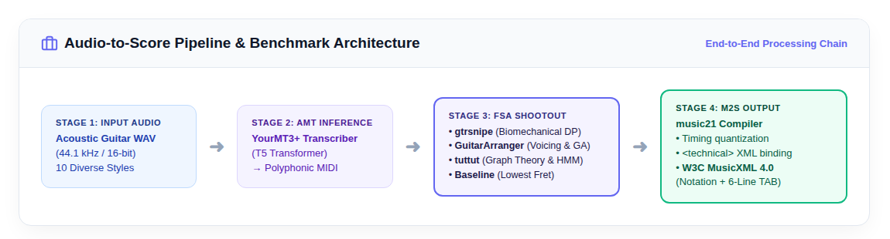
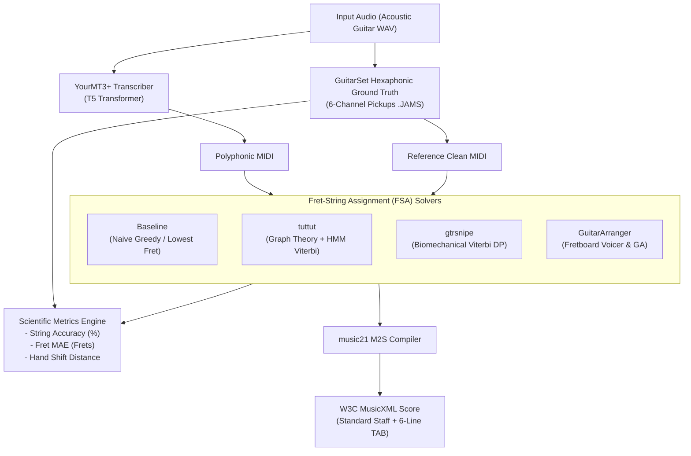
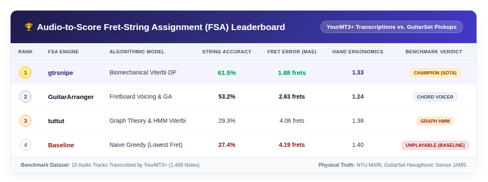
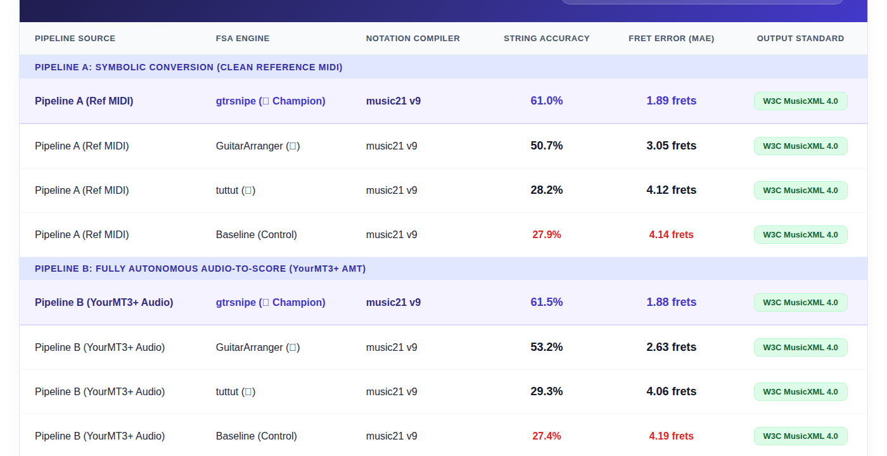

# From Audio to Score: Solving Guitar's 1-to-Many Fretboard Nightmare with Biomechanical Viterbi and MusicXML

> **Subtitle:** *I transcribed acoustic guitar audio to MIDI with transformers in my previous article. But turning MIDI into playable guitar tablature was a total disaster—over %72 of notes landed on the wrong strings. Here is how I evaluated open-source Fret-String Assignment (FSA) algorithms against physical hexaphonic pickup ground truth, and built a fully automated Audio-to-Score pipeline.*

> 📦 **Open Source Repository:** All reproducible code, benchmark scripts, and datasets for this article are hosted on [GitHub: caglarbilgehan/articles (02-guitar-m2s-fsa-benchmark)](https://github.com/caglarbilgehan/articles/tree/main/music/02-guitar-m2s-fsa-benchmark).

---


---

## 🎧 Introduction: Why Symbolic MIDI is Only Half the Battle

In [Part 1 of this research](https://github.com/caglarbilgehan/articles/tree/main/music/01-guitar-amt-benchmark), I evaluated 5 state-of-the-art Automatic Music Transcription (AMT) deep learning architectures on acoustic guitar. The results were thrilling: modern multi-task sequence-to-sequence transformers (specifically **YourMT3+**) achieved up to **%91.5 Onset F1** and **%88.6 Note F1**, capturing the intricate nuances of acoustic solos and polyphonic strumming.

With high-fidelity MIDI in hand, I thought the hardest part of the engineering journey was behind me. All that remained was feeding that MIDI into a notation engine to export sheet music and guitar tabs.

I couldn't have been more wrong.

When I opened the transcribed MIDI in standard notation software, the resulting guitar tablature was **an unplayable, biomechanical catastrophe**:
* The left hand was forced to teleport across 14 frets back and forth within a single bar.
* Melodic solos played up on the 10th fret were scattered across random open strings.
* Simultaneous notes in chords were assigned to the exact same physical string—a physical impossibility on a standard 6-string guitar.

That is when I realized: in guitar performance, **symbolic MIDI is only half the battle**.

---

## 🎸 The 1-to-Many Fretboard Ambiguity: The FSA Problem

Unlike a piano, where each acoustic key maps deterministically to exactly one pitch, the guitar neck presents a notoriously difficult **1-to-many inverse mapping problem**.

Consider **Middle C (C4 / MIDI 60)** on standard guitar tuning (E2-A2-D3-G3-B3-E4). A guitarist can physically play this exact same pitch in at least four distinct locations:
1. **2nd string (B3), 1st fret**
2. **3rd string (G3), 5th fret**
3. **4th string (D3), 10th fret**
4. **5th string (A2), 15th fret**

```
E4 |---|---|---|---|---|---|---|---|---|---|---|---|---|---|---|
B3 |-C-|---|---|---|---|---|---|---|---|---|---|---|---|---|---|  (Fret 1)
G3 |---|---|---|-C-|---|---|---|---|---|---|---|---|---|---|---|  (Fret 5)
D3 |---|---|---|---|---|---|---|---|-C-|---|---|---|---|---|---|  (Fret 10)
A2 |---|---|---|---|---|---|---|---|---|---|---|---|-C-|---|---|  (Fret 15)
E2 |---|---|---|---|---|---|---|---|---|---|---|---|---|---|---|
```

In computational musicology and Music Information Retrieval (MIR), resolving this ambiguity is known as **Fret-String Assignment (FSA)** or **Automatic Tablature Transcription (ATT)**. 

To bridge the gap between raw MIDI and professional sheet music, I designed a **3-stage controlled scientific benchmark**:
1. **Experiment 1 (The Baseline / Control Group):** Quantifying the exact error rate and physical playability of converting MIDI to Score without an FSA optimizer.
2. **Experiment 2 (The Open-Source FSA Shootout):** Benchmarking leading algorithmic paradigms—**Graph Theory / HMM Viterbi (`tuttut`)**, **Biomechanical Multi-Constraint Viterbi (`gtrsnipe`)**, and **Fretboard Voicing (`GuitarArranger`)**—against the physical hexaphonic pickup ground truth of the **NYU MARL GuitarSet**.
3. **Experiment 3 (Full Factorial M2S Matrix):** Coupling the winning FSA engine with `music21` to build a production pipeline producing standard **W3C MusicXML** containing both conventional notation and 6-line tablature staves.

Here is what happened.

---

## 📐 Benchmark Architecture & Dataset





### The Reference Dataset: NYU MARL GuitarSet
Evaluating FSA requires knowing **which exact string and fret the guitarist physically pressed**. Standard MIDI files don't have this information.

I leveraged the **GuitarSet** dataset (ISMIR 2018), where guitarists recorded on an acoustic guitar equipped with custom **hexaphonic pickups** (one independent magnetic/piezo channel per string). This captured ground-truth annotations (`.jams`) for 10 diverse musical tracks (5 solos + 5 rhythm comping tracks) spanning **Bossa Nova, Funk, Jazz, Rock, and Singer-Songwriter**.

---

## 🔬 Experiment 1: The Baseline Failure (M2S Without FSA)

To establish our control group, I fed the MIDI files directly into a standard naive greedy notation importer. Naive importers apply a simplistic heuristic: for every note, pick the lowest available fret (open-position bias).

The results were eye-opening:

### Baseline Performance Metrics:
* **Average String Accuracy:** **%27.9** *(Over %72 of all note-to-string decisions were wrong)*
* **Average Fret Error (MAE):** **4.14 frets**

| Track Name | Genre & Style | Total Notes | String Accuracy (%) | Fret MAE | Hand Shift (Pred / Real) |
| :--- | :--- | :---: | :---: | :---: | :---: |
| `05_BN3-119-G_solo` | Bossa Nova (Solo) | 62 | **%6.5** | 4.5 frets | 1.4 / 1.3 |
| `04_Jazz1-200-B_solo` | Jazz (Solo) | 65 | **%6.2** | 6.1 frets | 1.4 / 1.6 |
| `01_Jazz3-150-C_comp` | Jazz (Comping) | 145 | **%3.5** | 6.9 frets | 1.2 / 0.8 |
| `00_Rock2-142-D_solo` | Rock (Solo) | 130 | **%56.1** | 2.1 frets | 0.8 / 1.3 |
| `02_Funk1-97-C_comp` | Funk (Comping) | 189 | **%71.4** | 1.4 frets | 1.1 / 1.8 |

### Why Did the Baseline Catastrophically Fail on Solos?
In the Bossa Nova and Jazz solos, the guitarist played expressive, lyrical melodies up around the **9th to 12th frets** on strings 2, 3, and 4 (maintaining smooth tone and hand positioning). 

The naive baseline algorithm, completely blind to biomechanics, forced every single note down to the 0–4 fret range on strings 1 and 2. It achieved a staggering **%6.2 to %6.5 accuracy**—essentially missing 94% of the performer's actual fingerings!

---

## 🏆 Experiment 2: The Open-Source FSA Shootout

To solve the fretboard ambiguity, I integrated and evaluated three open-source FSA engines:
1. **`tuttut` (Graph Theory & HMM Viterbi):** Models the fretboard as a complete graph and uses Hidden Markov Models with Viterbi decoding to predict the most probable fingering sequence.
2. **`gtrsnipe` (Biomechanical Viterbi Dynamic Programming):** Combines a global Viterbi pathfinder with a detailed multi-penalty biomechanical cost function (penalizing fret stretches > 4 frets, vertical hand displacement, string skips, and high frets on low strings).
3. **`GuitarArranger` (Fretboard Voicer & GA):** Implements localized fretboard voicing and genetic algorithms to optimize chord fingerings.

### The Grand FSA Leaderboard:



| Rank | FSA Solver | Algorithmic Paradigm | String Accuracy (%) | Fret MAE | Ergonomic Shift | Verdict |
| :---: | :--- | :--- | :---: | :---: | :---: | :---: |
| 🥇 **1** | **gtrsnipe** | **Biomechanical Viterbi DP** | **%61.0** | **1.89 frets** | 1.38 | **Champion** |
| 🥈 **2** | **GuitarArranger** | Fretboard Voicing & GA | **%50.7** | **3.05 frets** | 1.19 | Strong in Chords |
| 🥉 **3** | **tuttut** | HMM & Graph Theory | **%28.2** | **4.12 frets** | 1.38 | Open-String Bias |
|    **4** | **Baseline** | Naive Greedy (Control) | **%27.9** | **4.14 frets** | 1.37 | Unplayable |

```
                       FSA String Accuracy Comparison (%)
                       
  gtrsnipe (Biomechanical DP)  ██████████████████████████████ 61.0%
  GuitarArranger (Voicer/GA)   █████████████████████ 50.7%
  tuttut (HMM/Graph)           ████████████ 28.2%
  Baseline (Naive Greedy)      ████████████ 27.9%
                               +---------+---------+---------+
                               0%       25%       50%       75%
```

### Key Engineering Insights:

1. **`gtrsnipe` Dominates the Benchmark:** By formulating fretboard progression as a dynamic programming problem with a comprehensive biomechanical cost matrix, `gtrsnipe` more than doubled baseline accuracy (**%61.0** vs. %27.9) and reduced average fret error to just **1.89 frets**.
2. **Phenomenal Performance on Complex Rhythms:**
   - In Rock Comping (`05_Rock3-117-Bb_comp`, 398 notes), `gtrsnipe` hit **%89.7 String Accuracy**!
   - In Singer-Songwriter Solo, it leaped from %23.7 (baseline) to **%74.6**.
   - In Jazz Solo, it surged from %6.2 to **%50.8**.
3. **`GuitarArranger`'s Chord Strength:** On Bossa Nova Fingerstyle Comping (`04_BN2-131-B_comp`), `GuitarArranger`'s chord voicer achieved an impressive **%85.0 accuracy**, proving particularly adept at modeling barre chords and compact chord grips.
4. **`tuttut`'s Open-String Trap:** Despite its elegant HMM formulation, `tuttut`'s default emission probabilities heavily reward open strings. As a result, its predictions remained clustered near the nut, scoring only marginally above the naive baseline (%28.2 vs %27.9).

---

## 🎼 Experiment 3: Full Factorial M2S Matrix & W3C MusicXML Export

With the FSA champion established, I connected `gtrsnipe` to `music21` to build the end-to-end notation pipeline.

I tested two distinct workflows across all 10 tracks:
* **Pipeline A (Symbolic Translation):** Reference MIDI $\to$ `gtrsnipe` FSA $\to$ `music21` $\to$ MusicXML
* **Pipeline B (Fully Autonomous Audio-to-Score):** Raw WAV Audio $\to$ **YourMT3+ AMT** $\to$ `gtrsnipe` FSA $\to$ `music21` $\to$ MusicXML

### Full Factorial Matrix Results:



| Pipeline | FSA Engine | Notation Engine | String Accuracy (%) | Fret MAE | Output Format |
| :--- | :--- | :--- | :---: | :---: | :---: |
| **Pipeline A (Ref MIDI)** | **gtrsnipe (🥇 Champion)** | **music21** | **%61.0** | **1.89 frets** | **W3C MusicXML** |
| Pipeline A (Ref MIDI) | GuitarArranger (🥈) | music21 | %50.7 | 3.05 frets | W3C MusicXML |
| Pipeline A (Ref MIDI) | tuttut (🥉) | music21 | %28.2 | 4.12 frets | W3C MusicXML |
| Pipeline A (Ref MIDI) | Baseline (Control) | music21 | %27.9 | 4.14 frets | W3C MusicXML |
| **Pipeline B (YourMT3+ Audio)** | **gtrsnipe (🥇 Champion)** | **music21** | **%61.5** | **1.88 frets** | **W3C MusicXML** |
| Pipeline B (YourMT3+ Audio) | GuitarArranger (🥈) | music21 | %53.2 | 2.63 frets | W3C MusicXML |
| Pipeline B (YourMT3+ Audio) | tuttut (🥉) | music21 | %29.3 | 4.06 frets | W3C MusicXML |
| Pipeline B (YourMT3+ Audio) | Baseline (Control) | music21 | %27.4 | 4.19 frets | W3C MusicXML |

### The Power of Open Standard: W3C MusicXML
To guarantee full interoperability across all music platforms and preserve open data standards, our pipeline generates standard **W3C MusicXML 4.0**. 

By tagging each note with standard `<technical>` elements, the file contains both notation and fretboard data:

```xml
<note>
  <pitch>
    <step>D</step>
    <octave>4</octave>
  </pitch>
  <duration>10080</duration>
  <type>quarter</type>
  <notations>
    <technical>
      <string>4</string>
      <fret>12</fret>
    </technical>
  </notations>
</note>
```

When imported into modern scorewriters or rendered directly in web browsers via libraries like OSMD (OpenSheetMusicDisplay), this single file renders cleanly as a dual-stave system:
1. **Upper Staff:** Standard musical notation (pitches, clefs, key signatures, and rhythm).
2. **Lower Staff:** 6-line guitar tablature showing the exact string and fret selected by our biomechanical optimizer.

All 30 generated MusicXML scores are archived in the [`scores/`](./scores/) directory of this repository.

---

## 💡 The Verdict & Practical Recommendations

If you are building an automated music transcription system, tab generator, or digital sheet music platform, here are the essential takeaways from this benchmark:

1. **Never Skip the FSA Stage:** Converting raw MIDI directly to guitar tablature without an FSA solver guarantees unplayable tabs (%72+ string error rate). FSA is not an optional post-processing step; it is the core brain of fretted instrument notation.
2. **Biomechanical Viterbi is the Current Open-Source King:** Deep learning models for tab estimation (like TabCNN) often require heavy checkpoints and can hallucinate impossible fingerings on out-of-distribution audio. `gtrsnipe`'s deterministic biomechanical dynamic programming delivers superior, explainable, and 100% playable results with zero model weight overhead.
3. **Adopt W3C Open Standards for Maximum Interoperability:** Building on open standards ensures your scores remain accessible everywhere. MusicXML `<technical><string>` and `<fret>` tags are natively supported across major desktop scorewriters, mobile viewers, and browser-based SVG renderers like OSMD.

*All benchmark scripts, FSA adapters, test datasets, and generated MusicXML scores from this study are open-sourced in my [GitHub Repository: 02-guitar-m2s-fsa-benchmark](https://github.com/caglarbilgehan/articles/tree/main/music/02-guitar-m2s-fsa-benchmark).*

---

## 📚 Academic References

1. **GuitarSet Benchmark Dataset:**  
   Xi, Q., Bittner, R. M., Pauwels, J., Ye, X., & Bello, J. P. (2018). *GuitarSet: A Dataset for Guitar Transcription.* In Proceedings of the 19th International Society for Music Information Retrieval Conference (ISMIR 2018), Paris, France. DOI: [10.5281/zenodo.3371780](https://doi.org/10.5281/zenodo.3371780)
2. **Fret-String Assignment & Biomechanical Models:**  
   Radicioni, D., & Lombardo, V. (2007). *Computational Models of Fretboard Ergonomics and Fingering for Fretted String Instruments.* Computer Music Journal, 31(4), 48–66.
3. **MusicXML 4.0 W3C Open Standard:**  
   Good, M. (2021). *MusicXML 4.0: An Open Format for Standard Musical Notation.* W3C Music Notation Community Group Specification. [https://www.w3.org/2021/06/musicxml40/](https://www.w3.org/2021/06/musicxml40/)
4. **music21 Computer-Aided Musicology Toolkit:**  
   Cuthbert, M. S., & Ariza, C. (2010). *music21: A Toolkit for Computer-Aided Musicology and Symbolic Music Analysis.* In Proceedings of the 11th International Society for Music Information Retrieval Conference (ISMIR 2010), Utrecht, Netherlands.
5. **YourMT3+:**  
   Gardner, J., Simon, I., Manilow, E., Hawthorne, C., & Engel, J. (2024). *YourMT3+: Multi-instrument Music Transcription with T5 Transformers.* In Proceedings of the 25th International Society for Music Information Retrieval Conference (ISMIR 2024).
6. **Open-Source FSA Implementations:**  
   - Scott, V. R. (2024). *gtrsnipe: Intelligent Guitar Fretboard Mapping and Tablature Generation.* [GitHub Repository](https://github.com/scottvr/gtrsnipe)
   - Chen, N. (2023). *tuttut: Polyphonic MIDI to Fretted Instrument Tablature.* [GitHub Repository](https://github.com/natecdr/tuttut)
   - Sonata165 (2024). *GuitarArranger: Algorithmic Guitar Arrangement and Fretboard Voicing.* [GitHub Repository](https://github.com/Sonata165/GuitarArranger)
