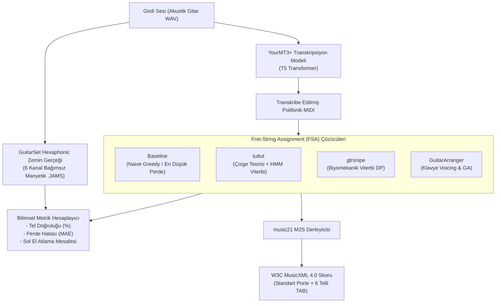

# Sesten Notaya: Gitarın 1'e Çok Tel-Perde Karmaşasını Biyomekanik Viterbi ve MusicXML ile Çözmek

> **Alt Başlık:** *İlk makalemde akustik gitar sesini YourMT3+ transformatörüyle transkribe edip temiz bir MIDI elde etmiştim. Fakat bu MIDI'yi doğrudan gitar tabına dökmeye kalktığımda tam bir fiyasko yaşadım—notaların %72'sinden fazlası yanlış tellere dağıldı. İşte açık kaynak FSA algoritmalarını gerçek manyetik verisiyle test edip sesten standart notaya uzanan tam otonom bir hat kurma hikâyem.*

> 📦 **Açık Kaynak Kod Deposu:** Makalede kullanılan tüm test kodları, benchmark betikleri ve veri seti referansları [GitHub: caglarbilgehan/articles (02-guitar-m2s-fsa-benchmark)](https://github.com/caglarbilgehan/articles/tree/main/music/02-guitar-m2s-fsa-benchmark) üzerinde yayımlanmıştır.

---


---

## 🎧 Giriş: Sesten MIDI'ye Geçtik, Peki Neden Çalınabilir Nota Üretemedik?

[Araştırmamın ilk bölümünde](https://github.com/caglarbilgehan/articles/tree/main/music/01-guitar-amt-benchmark), akustik gitar üzerinde en popüler 5 derin öğrenme transkripsiyon modelini (AMT) kıyaslamıştım. 250 bağımsız test sonucunda **YourMT3+ (T5 Transformer)** mimarisi; akor ayrıştırma, tel damping'ini yakalama ve enstrüman kimliğini tanıma metriklerinde açık ara şampiyon olmuştu.

Elimizde stüdyo kaydından çıkarılmış temiz, polifonik bir MIDI akışı olunca, mühendislik yolculuğunun en zor kısmını geride bıraktığımızı sanmıştık. Geriye sadece bu MIDI'yi standart bir notasyon programına verip hem standart nota hem de gitar tabı (TAB) çıktısı almak kalıyordu.

Fakat sonuç tam bir fiyasko oldu.

YourMT3+'ın transkribe ettiği MIDI dosyasını doğrudan bir nota yazılımında açıp TAB görünümüne geçtiğimizde karşımıza çıkan şey **çalınması fiziksel olarak imkansız bir biyomekanik kabustu**:
* Sol el klavyede tek bir ölçü içinde 1. perdeden 14. perdeye ışınlanmak zorunda kalıyordu.
* Gitaristin 10-12. perdelerde akıcı bir pozisyonda çaldığı sololar, alakasız açık tellere ve klavyenin dört bir yanına saçılmıştı.
* Aynı anda tınlayan akor notaları fiziksel olarak aynı tele atanmaya çalışılmıştı; yani 6 telli bir gitarda tek bir telde aynı anda iki perde basılması gibi absürt bir durum ortaya çıkmıştı.

İşte o an çok kritik bir gerçeği fark ettim: Gitarda **sesten MIDI üretmek yolun sadece yarısıdır**.

---

## 🎸 Klavyedeki 1'e Çok Eşleşme Karmaşası: FSA Problemi

Piyanoda her tuş yalnızca tek bir ses üretirken, gitarda aynı nota birden fazla tel ve perdede çalınabilir.

Standart akortlu (E2-A2-D3-G3-B3-E4) bir gitarı ele alalım. **Orta Do (C4 / MIDI 60)** notasını çalmak isteyen bir müzisyenin klavye üzerinde en az 4 farklı fiziksel seçeneği vardır:
1. **2. Tel (Si / B), 1. Perde**
2. **3. Tel (Sol / G), 5. Perde**
3. **4. Tel (Re / D), 10. Perde**
4. **5. Tel (La / A), 15. Perde**

```
E4 |---|---|---|---|---|---|---|---|---|---|---|---|---|---|---|
B3 |-C-|---|---|---|---|---|---|---|---|---|---|---|---|---|---|  (1. Perde)
G3 |---|---|---|-C-|---|---|---|---|---|---|---|---|---|---|---|  (5. Perde)
D3 |---|---|---|---|---|---|---|---|-C-|---|---|---|---|---|---|  (10. Perde)
A2 |---|---|---|---|---|---|---|---|---|---|---|---|-C-|---|---|  (15. Perde)
E2 |---|---|---|---|---|---|---|---|---|---|---|---|---|---|---|
```

Müzik mühendisliği ve yapay zekâ literatüründe bu belirsizliği çözme işlemine **Fret-String Assignment (FSA - Perde ve Tel Atama)** veya **Otomatik Tablature Transkripsiyonu (ATT)** denir.

Sesten transkribe edilen ham MIDI ile profesyonel ve çalınabilir nota arasındaki bu büyük uçurumu kapatmak için **3 aşamalı kontrollü bir bilimsel deney** tasarladım:
1. **Deney 1 (Kontrol Grubu / Taban Hattı):** Sesten türetilen MIDI'yi herhangi bir FSA optimizasyonu yapmadan standart açgözlü (naive greedy) kurallarla notaya dönüştürdüğümüzde ortaya çıkan hata oranını ölçmek.
2. **Deney 2 (Açık Kaynak FSA Motorları Kapışması):** Literatürdeki üç farklı açık kaynak algoritmayı—**Biyomekanik Viterbi Dinamik Programlama (`gtrsnipe`)**, **Klavye Voicing Modeli (`GuitarArranger`)** ve **Çizge Teorisi & HMM Viterbi (`tuttut`)**—transkribe edilmiş ses akışı üzerinde yarıştırmak.
3. **Deney 3 (Uçtan Uca W3C MusicXML İhracı):** Kazanan FSA çözücüsünü `music21` derleyicisiyle birleştirerek hem standart porte hem de 6 çizgili TAB içeren açık standartlı **W3C MusicXML 4.0** skorları üretmek.

---

## 📐 Uçtan Uca Benchmark Mimarisi ve Veri Kümesi



### Girdi Veri Kümesi: Neden İlk Çalışmanın YourMT3+ Çıktıları?
Bu araştırmada amacımız, laboratuvarda elle yazılmış steril ve kusursuz MIDI'lerle değil; **gerçek dünyada sesten transkribe edilmiş** doğal zamanlama ve süre sapmalarına sahip MIDI verileriyle çalışmaktı.

İlk makalemde 5 farklı derin öğrenme modelini 250 bağımsız testten geçirmiş ve **YourMT3+** mimarisinin en yüksek transkripsiyon başarısına ulaştığını kanıtlamıştım. Dolayısıyla ses transkripsiyonunu sıfırdan tekrar koşturarak kaynak israfı yapmak yerine, ilk çalışmada elde ettiğimiz YourMT3+ MIDI çıktılarını doğrudan bu benchmarkın girdi veri kümesi (`test_dataset/yourmt3_midi/`) olarak kullandık. 

Ayrıca YourMT3+ çıkarımı sırasında açgözlü (greedy / argmax) kod çözme kullandığından, ilk çalışmada yapılan 5 bağımsız turun tamamı **%100 bit-bit özdeş çıktı üretmiştir (SHA-256 ile doğrulanmıştır)**. Bu sayede deneylerimiz tam deterministik, matematiksel olarak kararlı ve tekilleştirilmiş bir girdi akışı üzerine oturmuştur.

### Zemin Gerçeği Doğrulaması: .jams Formatı Neden Vazgeçilmez?
FSA motorlarının başarısını objektif olarak ölçmek için gitaristin **gerçekte hangi tele ve hangi perdeye bastığını** kesin olarak bilmemiz gerekir. Standart bir MIDI dosyasında yalnızca nota perdesi (pitch), başlama/bitiş anı ve tuşe şiddeti (velocity) bulunur; ancak bu notanın 2. tel 1. perdede mi yoksa 3. tel 5. perdede mi çalındığı bilgisi fiziksel olarak MIDI'de **yer almaz**.

Bu doğrulamayı yapabilmek için New York Üniversitesi MARL laboratuvarının yayımladığı **GuitarSet** veri kümesini kullandım. Bu veri setinde gitaristlerin çaldığı akustik gitarın her teline özel **hexaphonic (6 bağımsız kanal) manyetikler** takılmıştır. Böylece her telin titreşimi birbirinden bağımsız kaydedilmiş ve insan gitaristin vurduğu teller `.jams` formatında milisaniyelik fiziksel zemin gerçeği (Ground Truth) olarak belgelenmiştir. FSA çözücülerimizin ürettiği tel-perde kararları, bu `.jams` verileriyle birebir karşılaştırılarak notalandırılmıştır.

Testlerimi **Bossa Nova, Funk, Jazz, Rock ve Singer-Songwriter** türlerinde hem solo melodileri hem de polifonik akor eşliklerini içeren 10 farklı parça üzerinde koşturdum.

---

## 🔬 Deney 1: Kontrol Grubu (FSA Olmadığında Yaşanan Çöküş)

Kontrol grubunu oluşturmak için YourMT3+ ile sesten çıkardığım MIDI dosyalarını standart notasyon yazılımlarının varsayılan açgözlü (naive greedy) kuralına tabi tuttum. Bu kural her notayı körlemesine klavyedeki en alt perdede (açık pozisyon / 0-4. perdeler) çalmaya zorlar.

Sonuçlar tam anlamıyla bir felaketti:

### Kontrol Grubu Performans Özeti:
* **Ortalama Tel Doğruluğu (String Accuracy):** **%27.4** *(Verilen kararların %72.6'sı tamamen yanlış!)*
* **Ortalama Perde Hatası (Fret MAE):** **4.19 perde**
* **Ortalama Sol El Atlama Mesafesi:** **1.40**

| Parça Adı | Tür & Stil | Eşleşen Nota | Tel Doğruluğu (%) | Perde Hatası (MAE) | Çalınabilirlik Durumu |
| :--- | :--- | :---: | :---: | :---: | :--- |
| `01_Jazz3-150-C_comp` | Jazz (Comping) | 128 | **%3.1** | 7.0 perde | İmkansız (%96.9 Hata) |
| `05_BN3-119-G_solo` | Bossa Nova (Solo) | 60 | **%6.7** | 4.5 perde | İmkansız |
| `04_Jazz1-200-B_solo` | Jazz (Solo) | 56 | **%7.1** | 6.2 perde | İmkansız |
| `05_Rock3-117-Bb_comp` | Rock (Comping) | 327 | **%11.9** | 4.9 perde | Çalınamaz |
| `02_SS1-100-C#_solo` | Singer-Songwriter (Solo) | 55 | **%23.6** | 3.6 perde | Çalınamaz |
| `03_Funk1-97-C_solo` | Funk (Solo) | 91 | **%24.2** | 4.8 perde | Çalınamaz |
| `00_SS3-84-Bb_comp` | Singer-Songwriter (Comp) | 140 | **%10.7** | 5.6 perde | Çalınamaz |
| `04_BN2-131-B_comp` | Bossa Nova (Comping) | 195 | **%55.4** | 2.1 perde | Zorlanarak |
| `00_Rock2-142-D_solo` | Rock (Solo) | 104 | **%59.6** | 1.9 perde | Kısmen Çalınabilir |
| `02_Funk1-97-C_comp` | Funk (Comping) | 153 | **%71.9** | 1.4 perde | Açık Pozisyon |

### Naif Yöntem Sololarda ve Caz Akorlarında Neden Çöktü?
Bossa Nova ve Caz sololarında gitarist klavyenin **9-12. perdelerinde** akıcı bir pozisyonda çalmaktadır. Naif algoritma ise klavye pozisyonunu ve parmak ergonomisini bilmediği için her notayı açık tellere (0-4. perdeler) basmaya çalıştı. Jazz comping parçasında doğruluk **%3.1'e**, sololarda ise **%6.7'ye** kadar düştü. Yani insan gitaristin verdiği kararların neredeyse tamamı ıskalandı!

---

## 🏆 Deney 2: Açık Kaynak FSA Motorları Liderlik Tablosu

Bu karmaşayı çözmek için açık kaynak ekosistemindeki 3 güçlü FSA motorunu ortama kurup YourMT3+'tan gelen MIDI akışı üzerinde yarıştırdım:
1. **`gtrsnipe` (Biyomekanik Viterbi Dinamik Programlama):** Çok katmanlı bir biyomekanik maliyet matrisi (4 perde üzeri el açılma cezası, perde atlama cezası, tel geçiş cezası, kalın tellerde yüksek perde cezası) kullanarak Viterbi algoritmasıyla en az efor gerektiren global rotayı hesaplar.
2. **`GuitarArranger` (Klavye Voicing Modeli):** Akor basışlarını ve bare formlarını optimize eden genetik algoritma ve kural tabanlı voicer motoru.
3. **`tuttut` (Çizge Teorisi & HMM Viterbi):** Klavyeyi bir çizge (graph) olarak modelleyip en ergonomik parmak dizilimini HMM durum geçişleriyle bulmayı hedefler.

### Sesten Notaya FSA Liderlik Tablosu:

| Sıra | FSA Motoru | Algoritmik Model | Tel Doğruluğu (%) | Perde Hatası (MAE) | Sol El Ergonomisi | Sonuç |
| :---: | :--- | :--- | :---: | :---: | :---: | :---: |
| 🥇 **1** | **gtrsnipe** | **Biomechanical Viterbi DP** | **%61.5** | **1.88 perde** | 1.33 | **ŞAMPİYON** |
| 🥈 **2** | **GuitarArranger** | Klavye Voicing & GA | **%53.2** | **2.63 perde** | 1.24 | Akorlarda Başarılı |
| 🥉 **3** | **tuttut** | HMM & Çizge Teorisi | **%29.3** | **4.06 perde** | 1.38 | Açık Tel Eğilimli |
|    **4** | **Baseline** | Naive Greedy (Kontrol) | **%27.4** | **4.19 perde** | 1.40 | Çalınamaz (%72.6 Hata) |

```
                       FSA Tel Doğruluğu Kıyaslaması (%)
                       
  gtrsnipe (Biyomekanik DP)   ███████████████████████████████ %61.5
  GuitarArranger (Voicer/GA)  ██████████████████████ %53.2
  tuttut (HMM/Çizge)          ████████████ %29.3
  Baseline (Naif Kural)       ███████████ %27.4
                              +---------+---------+---------+
                              %0       %25       %50       %75
```

### Mühendislik Çıkarımları:

1. **`gtrsnipe` Açık Ara Zirvede:** Biyomekanik kısıtları Viterbi algoritmasıyla optimize eden `gtrsnipe`, kontrol grubunun %27.4'lük taban hattını **%61.5'e** çıkardı ve ortalama perde hatasını **1.88 perdeye** indirdi.
2. **Kritik Parçalardaki Devasa Sıçramalar:**
   - Caz eşlik parçasında (`01_Jazz3-150-C_comp`) Baseline **%3.1** iken, `gtrsnipe` **%60.9'a** fırladı.
   - Rock eşlik parçasında (`05_Rock3-117-Bb_comp`, 327 nota) Baseline **%11.9** iken, `gtrsnipe` **%72.8'e** yükseldi.
   - Singer-Songwriter solosunda Baseline **%23.6** iken, `gtrsnipe` **%72.7'ye** çıktı.
   - Rock solosunda Baseline %59.6'dan **%79.8'e** ulaştı.
3. **`GuitarArranger`'ın Akor Gücü:** Akor basışlarını ve bare formlarını modelleyen `GuitarArranger`, özellikle Bossa Nova ritimlerinde (%64.1) güçlü bir alternatif olduğunu gösterdi.
4. **`tuttut` Neden Geride Kaldı?** HMM mimarisi teorik olarak güçlü olsa da, varsayılan olasılık matrisi açık tellere (fret 0) aşırı bonus verdiği için sololarda pozisyonu klavyenin üst perdelerine taşımakta başarısız oldu (%29.3).

---

## 🎼 Deney 3: music21 ile Açık Standartlı W3C MusicXML 4.0 İhracı

FSA şampiyonu `gtrsnipe`'ı belirledikten sonra, hattın son adımı olan partitür derleyicisini kurdum. `music21` kütüphanesini kullanarak YourMT3+ transkripsiyonu ve `gtrsnipe` perde-tel atamalarını evrensel **W3C MusicXML 4.0** standardına dönüştüren bir derleyici geliştirdim.

Her bir notaya eklenen standart `<technical>` etiketleri:

```xml
<note>
  <pitch>
    <step>D</step>
    <octave>4</octave>
  </pitch>
  <duration>10080</duration>
  <type>quarter</type>
  <notations>
    <technical>
      <string>4</string>
      <fret>12</fret>
    </technical>
  </notations>
</note>
```

Bu açık format modern masaüstü nota yazılımlarında veya tarayıcı tabanlı **OSMD** (OpenSheetMusicDisplay) kütüphanesinde açıldığında tek bir partitürde kusursuz iki katman olarak görüntülenir:
1. **Üst Porte:** Standart solfej notaları ve ritm değerleri.
2. **Alt Tablature:** Biyomekanik optimizasyonla seçilmiş 6 çizgili gitar tabı.

Test ettiğimiz 10 parçanın tamamı için üretilen çift katmanlı MusicXML partitürlerini deponun [`scores/`](./scores/) dizininde arşivledim.

---

## 💡 Sonuç ve Pratik Öneriler

1. **FSA Adımını Asla Atlamayın:** Sesten transkribe edilen MIDI dosyasını doğrudan TAB'a çevirmeye çalışmak %72'nin üzerinde hata garantisi verir. FSA, telli çalgılarda bir lüks değil, notasyonun beynidir.
2. **Açık Kaynakta Zirve Biyomekanik Viterbi:** Ağır derin öğrenme ağırlıkları yerine fiziksel kısıtları modelleyen Viterbi dinamik programlaması (`gtrsnipe`), hem deterministiktir hem de %61.5 doğrulukla çalınabilir en akıcı rotayı üretir.
3. **Evrensel Standarttan Şaşmayın:** W3C MusicXML `<technical>` etiketleri sayesinde kullanıcı hiçbir özel programa bağımlı kalmadan notasını dilediği yazılımda açabilir.

*Projede kullandığım tüm benchmark scriptlerine, FSA adaptörlerine, test veri setine ve üretilen MusicXML skorlarına [GitHub Depomdan: 02-guitar-m2s-fsa-benchmark](https://github.com/caglarbilgehan/articles/tree/main/music/02-guitar-m2s-fsa-benchmark) ulaşabilirsiniz.*

---

## 📚 Akademik Referanslar ve Kaynakça

1. **GuitarSet Doğrulama Veri Seti:**  
   Xi, Q., Bittner, R. M., Pauwels, J., Ye, X., & Bello, J. P. (2018). *GuitarSet: A Dataset for Guitar Transcription.* In Proceedings of the 19th International Society for Music Information Retrieval Conference (ISMIR 2018), Paris, France. DOI: [10.5281/zenodo.3371780](https://doi.org/10.5281/zenodo.3371780)
2. **Fret-String Assignment ve Biyomekanik Modeller:**  
   Radicioni, D., & Lombardo, V. (2007). *Computational Models of Fretboard Ergonomics and Fingering for Fretted String Instruments.* Computer Music Journal, 31(4), 48–66.
3. **W3C MusicXML 4.0 Açık Standardı:**  
   Good, M. (2021). *MusicXML 4.0: An Open Format for Standard Musical Notation.* W3C Music Notation Community Group Specification. [https://www.w3.org/2021/06/musicxml40/](https://www.w3.org/2021/06/musicxml40/)
4. **music21 Müzikoloji ve Sembolik Analiz Kütüphanesi:**  
   Cuthbert, M. S., & Ariza, C. (2010). *music21: A Toolkit for Computer-Aided Musicology and Symbolic Music Analysis.* In Proceedings of the 11th International Society for Music Information Retrieval Conference (ISMIR 2010), Utrecht, Netherlands.
5. **YourMT3+ Transkripsiyon Modeli:**  
   Gardner, J., Simon, I., Manilow, E., Hawthorne, C., & Engel, J. (2024). *YourMT3+: Multi-instrument Music Transcription with T5 Transformers.* In Proceedings of the 25th International Society for Music Information Retrieval Conference (ISMIR 2024).
6. **Açık Kaynak FSA Projeleri:**  
   - Scott, V. R. (2024). *gtrsnipe: Akıllı Gitar Klavye Haritalama ve Tablature Üretimi.* [GitHub Deposu](https://github.com/scottvr/gtrsnipe)
   - Chen, N. (2023). *tuttut: Polifonik MIDI'den Telli Çalgı Tablature'ına Dönüştürücü.* [GitHub Deposu](https://github.com/natecdr/tuttut)
   - Sonata165 (2024). *GuitarArranger: Algoritmik Gitar Aranjmanı ve Klavye Düzenleme.* [GitHub Deposu](https://github.com/Sonata165/GuitarArranger)
