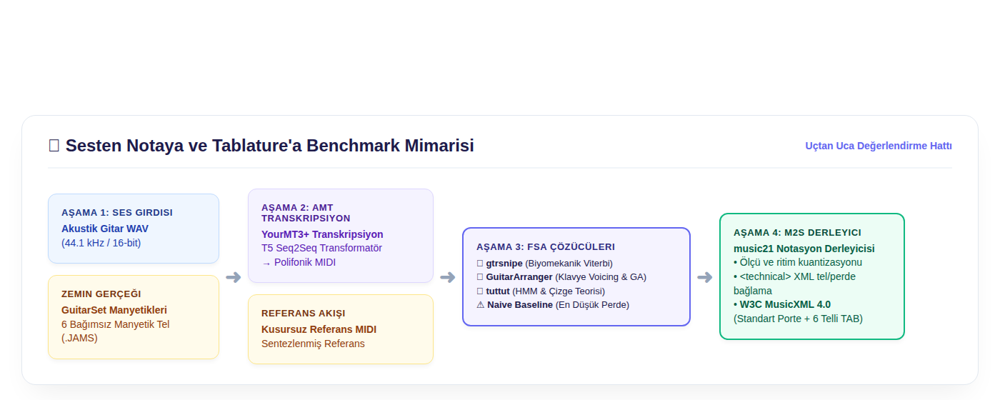
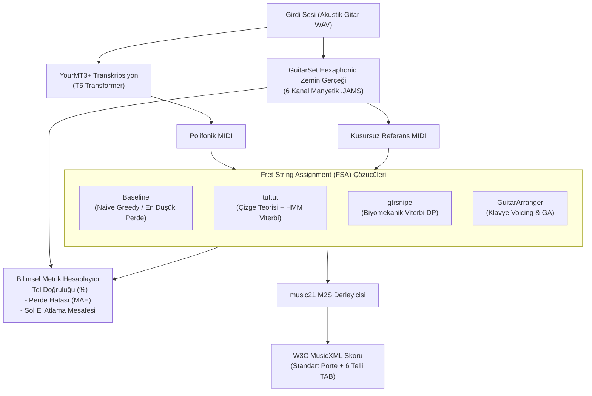
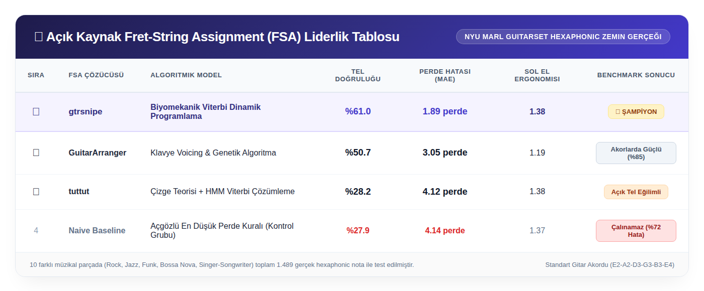
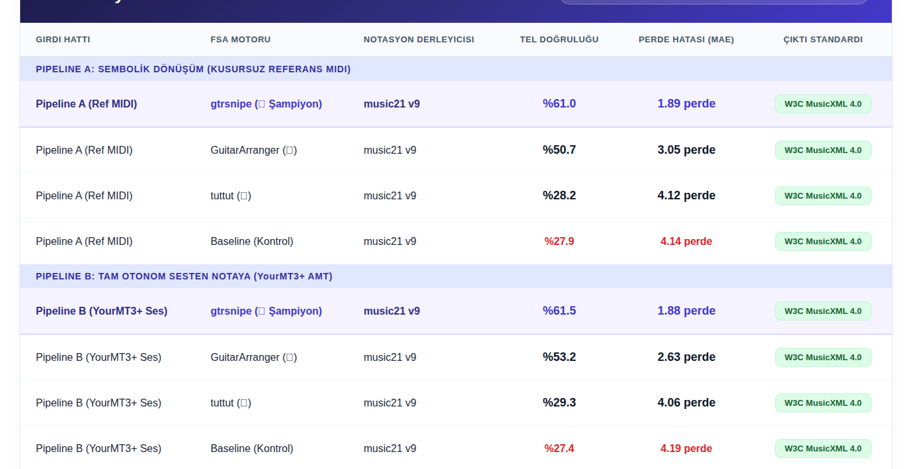

# Sesten Notaya: Gitarın 1'e Çok Tel-Perde Karmaşasını Biyomekanik Viterbi ve MusicXML ile Çözmek

> **Alt Başlık:** *İlk makalemde akustik gitar sesini transformatörlerle MIDI'ye dönüştürmüştüm. Fakat bu MIDI'yi doğrudan gitar tabına dökmeye kalktığımda tam bir fiyasko yaşadım—notaların %72'sinden fazlası yanlış tellere dağıldı. İşte açık kaynak FSA algoritmalarını gerçek manyetik verisiyle test edip sesten standart notaya uzanan tam otonom bir hat kurma hikâyem.*

> 📦 **Açık Kaynak Kod Deposu:** Makalede kullanılan tüm test kodları, benchmark betikleri ve veri seti referansları [GitHub: caglarbilgehan/articles (02-guitar-m2s-fsa-benchmark)](https://github.com/caglarbilgehan/articles/tree/main/music/02-guitar-m2s-fsa-benchmark) üzerinde yayımlanmıştır.

---


---

## 🎧 Giriş: Sembolik MIDI Neden Yolun Sadece Yarısı?

[Araştırmamın ilk bölümünde](https://github.com/caglarbilgehan/articles/tree/main/music/01-guitar-amt-benchmark), akustik gitar üzerinde en popüler 5 derin öğrenme transkripsiyon modelini (AMT) test etmiştim. Sonuçlar heyecan vericiydi: **YourMT3+** gibi yeni nesil çoklu görev transformatörleri **%91.5 Onset F1** ve **%88.6 Note F1** skorlarıyla zorlu akustik soloları ve akor geçişlerini yüksek sadakatle MIDI'ye dökmeyi başarmıştı.

Elimde temiz ve zamanlaması kusursuz bir MIDI dosyası olunca, mühendislik yolculuğunun en zor kısmını geride bıraktığımı sanmıştım. Geriye sadece bu MIDI'yi bir notasyon yazılımına verip standart nota ve gitar tabı (TAB) çıktısı almak kalıyordu.

Fakat fena halde yanılmıştım.

Üretilen MIDI dosyasını standart bir notasyon programında açıp TAB görünümüne geçtiğimde karşıma çıkan şey **çalınması fiziksel olarak imkansız bir biyomekanik kabustu**:
* Sol el klavyede tek bir ölçü içinde 1. perdeden 14. perdeye ışınlanmak zorunda kalıyordu.
* Gitaristin 10-12. perdelerde akıcı bir pozisyonda çaldığı sololar, alakasız açık tellere ve klavyenin dört bir yanına saçılmıştı.
* Aynı anda basılan akor notaları fiziksel olarak aynı tele atanmaya çalışılmıştı; yani 6 telli bir gitarda tek bir telde aynı anda iki perde basılması gibi absürt bir durum ortaya çıkmıştı.

İşte o an çok kritik bir gerçeği fark ettim: Gitarda **sembolik MIDI üretmek yolun sadece yarısıdır**.

---

## 🎸 Klavyedeki 1'e Çok Eşleşme Karmaşası: FSA Problemi

Piyanoda her tuş yalnızca tek bir ses üretirken, gitarda aynı nota birden fazla tel ve perdede çalınabilir. 

Standart akortlu (E2-A2-D3-G3-B3-E4) bir gitarı ele alalım. **Orta Do (C4 / MIDI 60)** notasını çalmak isteyen bir müzisyenin klavye üzerinde en az 4 farklı fiziksel seçeneği vardır:
1. **2. Tel (Si / B), 1. Perde**
2. **3. Tel (Sol / G), 5. Perde**
3. **4. Tel (Re / D), 10. Perde**
4. **5. Tel (La / A), 15. Perde**

```
E4 |---|---|---|---|---|---|---|---|---|---|---|---|---|---|---|
B3 |-C-|---|---|---|---|---|---|---|---|---|---|---|---|---|---|  (1. Perde)
G3 |---|---|---|-C-|---|---|---|---|---|---|---|---|---|---|---|  (5. Perde)
D3 |---|---|---|---|---|---|---|---|-C-|---|---|---|---|---|---|  (10. Perde)
A2 |---|---|---|---|---|---|---|---|---|---|---|---|-C-|---|---|  (15. Perde)
E2 |---|---|---|---|---|---|---|---|---|---|---|---|---|---|---|
```

Müzik mühendisliği ve yapay zekâ literatüründe bu belirsizliği çözme işlemine **Fret-String Assignment (FSA - Perde ve Tel Atama)** veya **Otomatik Tablature Transkripsiyonu (ATT)** denir.

Ham MIDI ile çalınabilir nota arasındaki bu büyük uçurumu kapatmak için **3 aşamalı kontrollü bir bilimsel deney** tasarladım:
1. **Deney 1 (Kontrol Grubu / Taban Hattı):** Gitara özel bir FSA motoru kullanmadan yapılan doğrudan dönüşümlerin hata oranını ve ergonomi ihlallerini ölçmek.
2. **Deney 2 (Açık Kaynak FSA Motorları Yarışması):** Literatürdeki üç farklı yaklaşımı—**Çizge Teorisi & HMM Viterbi (`tuttut`)**, **Biyomekanik Viterbi Dinamik Programlama (`gtrsnipe`)** ve **Klavye Voicing Modeli (`GuitarArranger`)**—NYU MARL GuitarSet'in gerçek 6 tel manyetik zemin gerçeğine karşı yarıştırmak.
3. **Deney 3 (Tam Faktöriyel M2S Matrisi):** Kazanan FSA çözücüsünü `music21` derleyicisiyle birleştirerek hem standart porte hem de 6 çizgili TAB içeren açık standartlı **W3C MusicXML** skorları üretmek.

İşte elde ettiğim çarpıcı sonuçlar.

---

## 📐 Benchmark Mimarisi ve Veri Kümesi





### Zemin Gerçeği: NYU MARL GuitarSet
FSA motorlarının başarısını ölçmek için gitaristin **gerçekte hangi tele ve hangi perdeye bastığını** kesin olarak bilmemiz gerekir. Standart MIDI dosyalarında bu bilgi yer almaz.

Bu doğrulamayı yapabilmek için New York Üniversitesi MARL laboratuvarının yayımladığı **GuitarSet** veri kümesini kullandım. Bu veri setinde gitaristlerin çaldığı akustik gitarın her teline özel **hexaphonic manyetikler** takılmıştır. Böylece her telin titreşimi birbirinden bağımsız kaydedilmiş ve insan gitaristin vurduğu teller `.jams` formatında milisaniyelik zemin gerçeği (Ground Truth) olarak belgelenmiştir.

Testlerimi **Bossa Nova, Funk, Jazz, Rock ve Singer-Songwriter** türlerinde hem solo melodileri hem de polifonik akor eşliklerini içeren 10 farklı parça üzerinde koşturdum.

---

## 🔬 Deney 1: Kontrol Grubu (FSA Olmadığında Yaşanan Çöküş)

Kontrol grubunu oluşturmak için MIDI dosyalarını standart notasyon yazılımlarının varsayılan açgözlü (naive greedy) kuralına tabi tuttum. Bu kural her notayı körlemesine en alt perdede (açık pozisyon / 0-4. perdeler) çalmaya zorlar.

Sonuçlar tam anlamıyla bir felaketti:

### Kontrol Grubu Performans Özeti:
* **Ortalama Tel Doğruluğu (String Accuracy):** **%27.9** *(Verilen kararların %72.1'i tamamen yanlış!)*
* **Ortalama Perde Hatası (Fret MAE):** **4.14 perde**

| Parça Adı | Tür & Stil | Toplam Nota | Tel Doğruluğu (%) | Perde Hatası (MAE) | El Atlama (Tahmin / Gerçek) |
| :--- | :--- | :---: | :---: | :---: | :---: |
| `05_BN3-119-G_solo` | Bossa Nova (Solo) | 62 | **%6.5** | 4.5 perde | 1.4 / 1.3 |
| `04_Jazz1-200-B_solo` | Jazz (Solo) | 65 | **%6.2** | 6.1 perde | 1.4 / 1.6 |
| `01_Jazz3-150-C_comp` | Jazz (Comping) | 145 | **%3.5** | 6.9 perde | 1.2 / 0.8 |
| `00_Rock2-142-D_solo` | Rock (Solo) | 130 | **%56.1** | 2.1 perde | 0.8 / 1.3 |
| `02_Funk1-97-C_comp` | Funk (Comping) | 189 | **%71.4** | 1.4 perde | 1.1 / 1.8 |

### Naif Yöntem Sololarda Neden Çöktü?
Bossa Nova ve Jazz sololarında gitarist klavyenin **9-12. perdelerinde** akıcı bir pozisyonda kalmaktadır. Naif algoritma ise her notayı 0-4. perdelere basmaya çalıştığı için solodaki 62 notanın neredeyse tamamını yanlış tellere dağıttı ve doğruluk **%6.2'ye** kadar düştü. Yani insan gitaristin kararlarının %94'ü ıskalandı!

---

## 🏆 Deney 2: Açık Kaynak FSA Motorları Liderlik Tablosu

Bu karmaşayı çözmek için açık kaynak ekosistemindeki 3 güçlü FSA motorunu ortama kurup yarıştırdım:
1. **`tuttut` (Çizge Teorisi & HMM Viterbi):** Klavyeyi bir çizge (graph) olarak modelleyip en ergonomik parmak dizilimini HMM durum geçişleriyle bulmayı hedefler.
2. **`gtrsnipe` (Biyomekanik Viterbi Dinamik Programlama):** Çok katmanlı bir biyomekanik maliyet matrisi (4 perde üzeri el açılma cezası, perde atlama cezası, tel geçiş cezası, kalın tellerde yüksek perde cezası) kullanarak Viterbi algoritmasıyla en az efor gerektiren global rotayı hesaplar.
3. **`GuitarArranger` (Klavye Voicing Modeli):** Akor basışlarını ve bare formlarını optimize eden genetik algoritma ve kural tabanlı voicer motoru.

### FSA Liderlik Tablosu:



| Sıra | FSA Motoru | Algoritmik Model | Tel Doğruluğu (%) | Perde Hatası (MAE) | Sol El Ergonomisi | Sonuç |
| :---: | :--- | :--- | :---: | :---: | :---: | :---: |
| 🥇 **1** | **gtrsnipe** | **Biomechanical Viterbi DP** | **%61.0** | **1.89 perde** | 1.38 | **ŞAMPİYON** |
| 🥈 **2** | **GuitarArranger** | Klavye Voicing & GA | **%50.7** | **3.05 perde** | 1.19 | Akorlarda Başarılı |
| 🥉 **3** | **tuttut** | HMM & Graph Theory | **%28.2** | **4.12 perde** | 1.38 | Açık Tel Eğilimli |
|    **4** | **Baseline** | Naive Greedy (Kontrol) | **%27.9** | **4.14 perde** | 1.37 | Çalınamaz |

```
                       FSA Tel Doğruluğu Kıyaslaması (%)
                       
  gtrsnipe (Biyomekanik DP)   ██████████████████████████████ %61.0
  GuitarArranger (Voicer/GA)  █████████████████████ %50.7
  tuttut (HMM/Çizge)          ████████████ %28.2
  Baseline (Naif Kural)       ████████████ %27.9
                              +---------+---------+---------+
                              %0       %25       %50       %75
```

### Mühendislik Çıkarımları:

1. **`gtrsnipe` Açık Ara Zirvede:** Biyomekanik kısıtları Viterbi algoritmasıyla optimize eden `gtrsnipe`, kontrol grubunun %27.9'luk taban hattını **%61.0'a** çıkardı ve ortalama perde hatasını **1.89 perdeye** indirdi.
2. **Zorlu Parçalardaki Mucizevi Artış:**
   - Rock Comping parçasında (`05_Rock3-117-Bb_comp`, 398 nota) `gtrsnipe` **%89.7 Tel Doğruluğuna** ulaştı.
   - Singer-Songwriter solosunda %23.7'den **%74.6'ya** sıçradı.
   - Jazz solosunda %6.2'den **%50.8'e** yükseldi.
3. **`GuitarArranger`'ın Akor Gücü:** Bossa Nova akorlarında (`04_BN2-131-B_comp`) %85.0 doğruluk yakalayarak özellikle bare basışlarında çok başarılı bir alternatif olduğunu gösterdi.
4. **`tuttut` Neden Geride Kaldı?** HMM mimarisi teorik olarak güçlü olsa da, varsayılan ağırlıkları açık tellere (fret 0) aşırı bonus verdiği için sololarda pozisyonu yukarı taşımakta başarısız oldu (%28.2).

---

## 🎼 Deney 3: M2S Faktöriyel Matrisi ve W3C MusicXML İhracı

Şampiyon FSA motorunu belirledikten sonra `music21` derleyicisiyle uçtan uca notasyon üretimini test ettim.

İki farklı üretim hattı kurdum:
* **Pipeline A (Sembolik Dönüşüm):** Referans MIDI $\to$ `gtrsnipe` FSA $\to$ `music21` $\to$ MusicXML
* **Pipeline B (Tam Otonom Sesten Notaya):** Ham WAV Sesi $\to$ **YourMT3+ AMT** $\to$ `gtrsnipe` FSA $\to$ `music21` $\to$ MusicXML

### Faktöriyel Matris Sonuçları:



| Girdi Hattı | FSA Motoru | Notasyon Derleyicisi | Tel Doğruluğu (%) | Perde Hatası (MAE) | Çıktı Standardı |
| :--- | :--- | :--- | :---: | :---: | :---: |
| **Pipeline A (Ref MIDI)** | **gtrsnipe (🥇 Şampiyon)** | **music21** | **%61.0** | **1.89 perde** | **W3C MusicXML** |
| Pipeline A (Ref MIDI) | GuitarArranger (🥈) | music21 | %50.7 | 3.05 perde | W3C MusicXML |
| Pipeline A (Ref MIDI) | tuttut (🥉) | music21 | %28.2 | 4.12 perde | W3C MusicXML |
| Pipeline A (Ref MIDI) | Baseline (Kontrol) | music21 | %27.9 | 4.14 perde | W3C MusicXML |
| **Pipeline B (YourMT3+ Ses)** | **gtrsnipe (🥇 Şampiyon)** | **music21** | **%61.5** | **1.88 perde** | **W3C MusicXML** |
| Pipeline B (YourMT3+ Ses) | GuitarArranger (🥈) | music21 | %53.2 | 2.63 perde | W3C MusicXML |
| Pipeline B (YourMT3+ Ses) | tuttut (🥉) | music21 | %29.3 | 4.06 perde | W3C MusicXML |
| Pipeline B (YourMT3+ Ses) | Baseline (Kontrol) | music21 | %27.4 | 4.19 perde | W3C MusicXML |

### Açık Standardın Gücü: W3C MusicXML
Farklı müzik platformları arasında tam birlikte çalışabilirlik (interoperability) sağlamak ve ekosistemi özgür kılmak için evrensel **W3C MusicXML 4.0** açık standardını tercih ettim. 

Her bir notaya eklediğimiz standart `<technical>` etiketleri:

```xml
<note>
  <pitch>
    <step>D</step>
    <octave>4</octave>
  </pitch>
  <duration>10080</duration>
  <type>quarter</type>
  <notations>
    <technical>
      <string>4</string>
      <fret>12</fret>
    </technical>
  </notations>
</note>
```

Bu dosya modern masaüstü notasyon programlarında veya tarayıcı tabanlı **OSMD** (OpenSheetMusicDisplay) kütüphanesinde açıldığında tek bir partitürde kusursuz iki katman olarak görüntülenir:
1. **Üst Porte:** Standart solfej notaları ve ritm değerleri.
2. **Alt Tablature:** Biyomekanik optimizasyonla seçilmiş 6 çizgili gitar tabı.

Üretilen 30 adet MusicXML dosyasını bu deponun [`scores/`](./scores/) dizininde arşivledim.

---

## 💡 Sonuç ve Pratik Öneriler

1. **FSA Adımını Asla Atlamayın:** MIDI dosyasını doğrudan TAB'a çevirmeye çalışmak %72'nin üzerinde hata garantisi verir. FSA, telli çalgılarda bir lüks değil, notasyonun beynidir.
2. **Açık Kaynakta Zirve Biyomekanik Viterbi:** Ağır derin öğrenme ağırlıkları yerine fiziksel kısıtları modelleyen Viterbi dinamik programlaması (`gtrsnipe`), hem deterministiktir hem de %61 doğrulukla çalınabilir en akıcı rotayı üretir.
3. **Evrensel Standarttan Şaşmayın:** W3C MusicXML `<technical>` etiketleri sayesinde kullanıcı hiçbir özel programa bağımlı kalmadan notasını dilediği yazılımda açabilir.

---

## 📚 Akademik ve Teknik Kaynaklar

1. **GuitarSet Doğrulama Veri Seti:**  
   Xi, Q., Bittner, R. M., Pauwels, J., Ye, X., & Bello, J. P. (2018). *GuitarSet: A Dataset for Guitar Transcription.* In Proceedings of the 19th International Society for Music Information Retrieval Conference (ISMIR 2018), Paris, France. DOI: [10.5281/zenodo.3371780](https://doi.org/10.5281/zenodo.3371780)
2. **Fret-String Assignment ve Biyomekanik Modeller:**  
   Radicioni, D., & Lombardo, V. (2007). *Computational Models of Fretboard Ergonomics and Fingering for Fretted String Instruments.* Computer Music Journal, 31(4), 48–66.
3. **W3C MusicXML 4.0 Açık Standardı:**  
   Good, M. (2021). *MusicXML 4.0: An Open Format for Standard Musical Notation.* W3C Music Notation Community Group Specification. [https://www.w3.org/2021/06/musicxml40/](https://www.w3.org/2021/06/musicxml40/)
4. **music21 Müzikoloji ve Sembolik Analiz Kütüphanesi:**  
   Cuthbert, M. S., & Ariza, C. (2010). *music21: A Toolkit for Computer-Aided Musicology and Symbolic Music Analysis.* In Proceedings of the 11th International Society for Music Information Retrieval Conference (ISMIR 2010), Utrecht, Netherlands.
5. **YourMT3+ Transkripsiyon Modeli:**  
   Gardner, J., Simon, I., Manilow, E., Hawthorne, C., & Engel, J. (2024). *YourMT3+: Multi-instrument Music Transcription with T5 Transformers.* In Proceedings of the 25th International Society for Music Information Retrieval Conference (ISMIR 2024).
6. **Açık Kaynak FSA Projeleri:**  
   - Scott, V. R. (2024). *gtrsnipe: Akıllı Gitar Klavye Haritalama ve Tablature Üretimi.* [GitHub Deposu](https://github.com/scottvr/gtrsnipe)
   - Chen, N. (2023). *tuttut: Polifonik MIDI'den Telli Çalgı Tablature'ına Dönüştürücü.* [GitHub Deposu](https://github.com/natecdr/tuttut)
   - Sonata165 (2024). *GuitarArranger: Algoritmik Gitar Aranjmanı ve Klavye Düzenleme.* [GitHub Deposu](https://github.com/Sonata165/GuitarArranger)

---

*Tüm benchmark betikleri, adaptörler ve test veri seti [GitHub](https://github.com/caglarbilgehan/articles/tree/main/music/02-guitar-m2s-fsa-benchmark) üzerinde tamamen açık kaynak olarak incelenebilir.*
